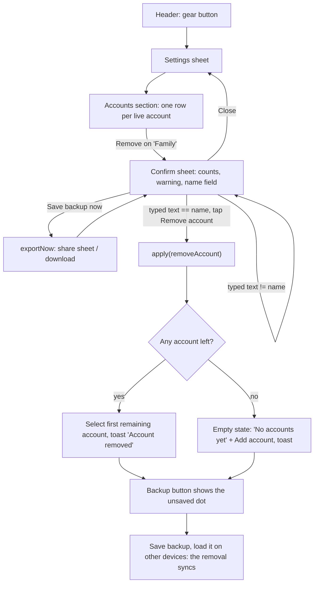
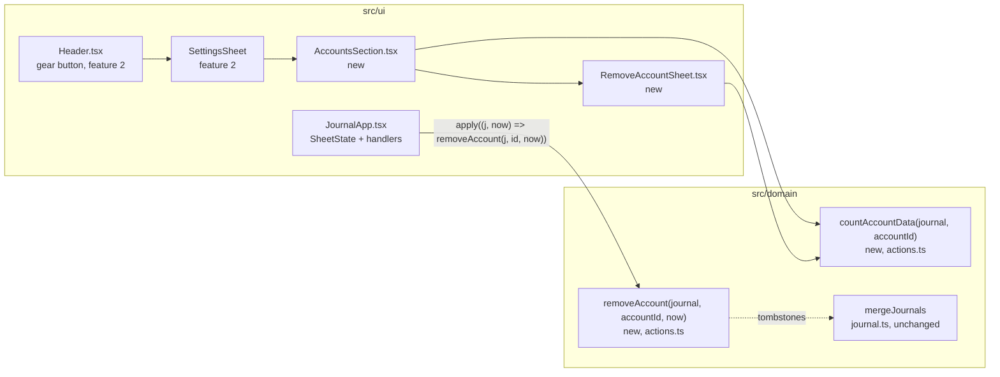
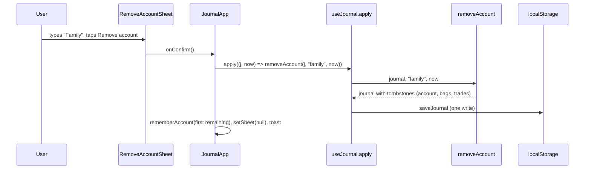

# Remove an account — plan

> **Status:** Shipped (2026-10-12) · **Owner:** @stanislavSav · **Decided:** 2026-10-12
> **Vocabulary:** [docs/CONTEXT.md](../CONTEXT.md) · **Decisions:** [docs/README.md](../README.md) G4, G5, G6 ·
> **Depends on:** feature 2 ([docs/i18n/plan.md](../i18n/plan.md): Settings sheet, `useT()`) ·
> **Tasks:** [tasks/](tasks/README.md) · **Parking lot:** [parking-lot/](parking-lot/README.md)

## 1. Why

An account (a tab at the top, e.g. "CS", "Family") can be added but never removed. A test account, a typo, or a
portfolio the owner no longer follows stays in the header and in every backup forever. Deleting it trade by trade is
slow, and the last trade of each bag must be deleted to make the bag go away (`src/domain/actions.ts:121-129`).

After this feature, Settings has an **Accounts** section. Each account has a **Remove** button. Removing deletes the
account with all its bags and trades in one step, and the deletion travels to other devices through backups like any
other edit.

## 2. Scope

**In:**

- Domain: `removeAccount(journal, accountId, now)` and `countAccountData(journal, accountId)` in
  `src/domain/actions.ts`, with tests.
- UI: an **Accounts** section in the Settings sheet (added by feature 2); a confirmation sheet that shows what will be
  deleted, warns to save a backup, and needs the account name typed.
- Selected-account fallback after removal; a toast.
- All new UI text in English and Ukrainian (G4).

**Out, deliberately:**

- **Rename an account.** The account id is the lower-case slug of its name (`src/domain/types.ts:17`,
  `src/domain/journal.ts:3-10`). A rename must either keep the old id (then id and name disagree: adding an account
  with the old name later is a silent no-op, `src/domain/actions.ts:160`, and `AddAccountSheet` checks "taken" by slug,
  `src/ui/AddAccountSheet.tsx:17-18`) or change the id (then every bag's `accountId` is rewritten, and another device
  that still uses the old id creates orphans on the next merge). Both need their own design. See §11.
- **Undo.** The typed name is the guard. See [parking lot](parking-lot/02-undo-after-removal.md).
- Removing coins. Coins are shared by all accounts (`src/domain/types.ts:22-27`); see §6, edge case E7.
- Cleaning up orphans that a later merge brings in. See §6 and [parking lot](parking-lot/01-orphans-after-merge.md).
- Moving bags from one account to another.

## 3. Decisions

| #   | Question                                   | Decision                                                                                                                                                                                                         |
| --- | ------------------------------------------ | ---------------------------------------------------------------------------------------------------------------------------------------------------------------------------------------------------------------- |
| D1  | What does "remove" delete?                 | The account, every bag of that account, and every trade of those bags. All become tombstones (`deleted: true`, `updatedAt: now`) in **one** `apply`, so one backup carries the whole removal (G6).                |
| D2  | How does the user confirm?                 | A confirmation sheet. The **Remove account** button is enabled only when the typed text equals the account name.                                                                                                  |
| D3  | Where is the Remove button?                | In Settings → **Accounts** (a section this feature adds to the Settings sheet from feature 2). Not in the header: the account tabs are for switching, and a long-press menu is hard to discover.                   |
| D4  | Is Rename in scope?                        | No (see §2 "Out").                                                                                                                                                                                               |
| D5  | May the last account be removed?           | Yes. The empty state already exists (`src/ui/JournalApp.tsx:129-136`: "No accounts yet." + **Add account**).                                                                                                      |
| D6  | Which account is selected after removal?   | The first remaining account in the header order (by name, `src/ui/portfolioView.ts:26-28`). JournalApp already falls back when the stored id is not live (`src/ui/JournalApp.tsx:44-45`); we also store the fallback id so the key never points to a removed account. |
| D7  | What happens to coins?                     | Nothing. Coins are global and may be used by other accounts. An unused coin only appears as a suggestion in the asset field (`src/ui/AddTradeSheet.tsx:53`).                                                       |
| D8  | Can a removed account come back?           | Adding an account with the same name revives the same id (`src/domain/actions.ts:156-163`), **empty**: its old bags and trades stay deleted. Loading an older backup does **not** bring it back (the tombstones are newer). |

**Defaults decided without a question** (reversible; flag in review if wrong):

- Settings section order: Language, **Accounts**, About. Each account row shows the name and "N bags · M trades".
- The name check: trim the typed text, normalise both strings to NFC, compare **case-sensitively**. Typing is with
  `autoCapitalize="off"`, `autoCorrect="off"`, `spellCheck={false}`.
- The confirmation sheet replaces the Settings sheet (no sheet on top of a sheet). **Close** goes back to Settings;
  a successful removal closes everything and shows the toast `Account "<name>" removed`.
- The confirmation sheet has a secondary **Save backup now** button that calls the same export as the Backup sheet
  (`useJournal().exportNow`, `src/state/useJournal.ts:70-74`). It shows "Backup saved" after a share or download. It
  is not required before removing.
- The counts count live records: live bags of the account, and live trades whose bag belongs to the account.
- Trades that are still live but whose bag is already deleted (possible after merges) are tombstoned too, so nothing
  of the account survives the removal on this device.
- Already-deleted records are not touched (their `updatedAt` stays), so the removal does not "win" over newer edits
  of records that were already gone.

## 4. User flow



## 5. Screens

ASCII wireframes are the contract (no interactive mockup for this feature). Wording is in §5.3.

### 5.1 Settings → Accounts section

```
┌──────────────────────────────┐
│ Settings               Close │
│ LANGUAGE                     │  (feature 2)
│ [ English | Українська ]     │
│ ACCOUNTS                     │  (this feature)
│ ┌──────────────────────────┐ │
│ │ CS                Remove │ │  Remove: red text button,
│ │ 5 bags · 23 trades       │ │  aria-label "Remove account CS"
│ ├──────────────────────────┤ │
│ │ Family            Remove │ │
│ │ 3 bags · 12 trades       │ │
│ └──────────────────────────┘ │
│ ABOUT                        │  (feature 2)
│ …                            │
└──────────────────────────────┘
```

With no accounts, the section shows "No accounts." and no list.

### 5.2 Confirmation sheet

```
┌──────────────────────────────┐
│ Remove "Family"        Close │  Close → back to Settings
│ ┌──────────────────────────┐ │
│ │ This deletes the account │ │
│ │ and everything in it:    │ │
│ │ 3 bags, 12 trades.       │ │  counts from countAccountData
│ │ It cannot be undone.     │ │
│ │ Loading an older backup  │ │
│ │ will not bring it back.  │ │
│ └──────────────────────────┘ │
│ Save a backup first, so you  │
│ still have the trades in a   │
│ file.                        │
│ [ Save backup now ]          │  secondary; → "Backup saved"
│                              │
│ Type Family to confirm       │  label
│ [______________________]     │  input, autoFocus off (keyboard
│                              │  would hide the warning)
│ [     Remove account     ]   │  danger style, disabled until
└──────────────────────────────┘  the text matches exactly
```

### 5.3 Strings (EN + UK)

Use the keys style that feature 2 sets up in `src/i18n/en.ts` / `src/i18n/uk.ts`; the keys below are suggestions.
**As shipped:** every string is in one group `accounts` (`accounts.title`, `.empty`, `.counts`, `.remove`,
`.removeLabel`, `.removeTitle`, `.what`, `.final`, `.backupHint`, `.saveBackup`, `.backupSaved`, `.typeToConfirm`,
`.confirm`, `.removed`); the bag and trade counts are plural helpers inside the two files. Two Ukrainian texts read
more naturally than the draft: «Цю дію не можна скасувати. …» and «Щоб підтвердити, введіть {name}».
The Ukrainian words are the ones the owner decided on 2026-10-12 for the whole app (feature 2 plan D17, D18): account =
«портфель» (masculine), bag = «позиція» (feminine), trade = «угода», and the polite Ви form. Counts use the plural
helper from feature 2 (Ukrainian has one / few / many forms).

| Key (suggested)                    | English                                                             | Ukrainian (draft, owner to check the wording)                                        |
| ---------------------------------- | ------------------------------------------------------------------- | ------------------------------------------------------------------------------------ |
| `settings.accounts.title`          | Accounts                                                            | Портфелі                                                                             |
| `settings.accounts.empty`          | No accounts.                                                        | Немає портфелів.                                                                     |
| `settings.accounts.counts`         | {bags} · {trades}                                                   | {bags} · {trades}                                                                    |
| `settings.accounts.remove`         | Remove                                                              | Видалити                                                                             |
| `settings.accounts.removeLabel`    | Remove account {name}                                               | Видалити портфель {name}                                                             |
| `count.bags` (plural)              | 1 bag / {n} bags                                                    | {n} позиція / {n} позиції / {n} позицій                                              |
| `count.trades` (plural)            | 1 trade / {n} trades                                                | {n} угода / {n} угоди / {n} угод                                                     |
| `removeAccount.title`              | Remove "{name}"                                                     | Видалити «{name}»                                                                    |
| `removeAccount.what`               | This deletes the account and everything in it: {bags}, {trades}.    | Буде видалено портфель і все, що в ньому: {bags}, {trades}.                          |
| `removeAccount.final`              | It cannot be undone. Loading an older backup will not bring it back. | Це не можна скасувати. Завантаження старішої резервної копії його не поверне.       |
| `removeAccount.backupHint`         | Save a backup first, so you still have the trades in a file.        | Спершу збережіть резервну копію, щоб угоди залишилися у файлі.                       |
| `removeAccount.saveBackup`         | Save backup now                                                     | Зберегти копію зараз                                                                 |
| `removeAccount.backupSaved`        | Backup saved                                                        | Копію збережено                                                                      |
| `removeAccount.typeToConfirm`      | Type {name} to confirm                                              | Введіть {name} для підтвердження                                                     |
| `removeAccount.confirm`            | Remove account                                                      | Видалити портфель                                                                    |
| `toast.accountRemoved`             | Account "{name}" removed                                            | Портфель «{name}» видалено                                                           |

## 6. Architecture



### 6.1 Seams

```ts
// src/domain/actions.ts
/** Live bags of the account, and live trades whose bag (live or deleted) belongs to the account. */
export function countAccountData(journal: Journal, accountId: string): { bags: number; trades: number }

/**
 * Tombstone a live account, every live bag of it, and every live trade whose bag belongs to it (live or deleted bag).
 * Records that are already deleted are not touched. Coins are not touched. Throws "Account not found".
 */
export function removeAccount(journal: Journal, accountId: string, now: number): Journal
```

- Reuses `putById`-style updates and the `{ ...record, deleted: true, updatedAt: now }` tombstone shape from
  `deleteTrade` (`src/domain/actions.ts:89-93`, `:121-129`).
- Exported through `src/domain/index.ts` (it re-exports `./actions`).
- `JournalApp` (`src/ui/JournalApp.tsx`):
  - `SheetState` (`:32-37`) gets `{ kind: 'removeAccount'; accountId: string }`. The `settings` kind comes from
    feature 2.
  - A `removeAccount` handler: `apply((j, now) => removeAccount(j, id, now))`, then store the fallback account
    (D6), close the sheet, toast (like `createAccount`, `:99-103`).
- `AccountsSection` gets `accounts` (from `liveAccounts`), `journal` (for counts) and `onRemove(accountId)`.
- `RemoveAccountSheet` gets `account`, `counts`, `onExport` (= `api.exportNow`), `onConfirm`, `onClose`. It uses
  `Sheet` (`src/ui/Sheet.tsx`) and `Field` (`src/ui/fields.tsx`) like `AddAccountSheet`.

### 6.2 Data change in one apply



### 6.3 Merge edge cases

The merge is per record: same id, newest `updatedAt` wins, tombstones included (`src/domain/journal.ts:133-150`).
"A" is the device that removes the account; "B" is another device with an older copy.

| #   | Case                                                                                         | Result                                                                                                                                                                                                                         | OK?                       |
| --- | -------------------------------------------------------------------------------------------- | ------------------------------------------------------------------------------------------------------------------------------------------------------------------------------------------------------------------------------ | ------------------------- |
| E1  | A removes, saves backup; B loads it                                                          | Every tombstone is newer → B loses the account, bags and trades. B's selected account falls back (D6).                                                                                                                         | Yes                       |
| E2  | Before syncing, B adds a trade to an **existing** bag of that account; then the journals merge | The trade has a new id, so it survives. Its bag stays deleted (adding a trade does not touch the bag's `updatedAt`, `src/domain/actions.ts:34-39`). The trade is a hidden **orphan**: no screen shows it (`src/domain/portfolio.ts:112-114`). The merge toast still counts it as "1 new" (`src/state/mergeCounts.ts:13-16`). | Parked                    |
| E3  | Before syncing, B starts a **new** bag in that account; then merge                           | The new bag and its trades survive with `accountId` of a deleted account. Hidden (the account tab is gone, `src/ui/portfolioView.ts:26-28`).                                                                                    | Parked                    |
| E4  | B **edits** a trade of that account; then merge                                              | Last write wins per record: if B's edit is newer than A's removal (by clock), that trade is live again, as an orphan (its bag is deleted). If older, it stays deleted.                                                          | Parked (same as E2)       |
| E5  | Later, an account with the **same name** is added (on any device)                            | `addAccount` writes a fresh record with the same id (`src/domain/actions.ts:156-163`): the account is back, **empty**. Old bags stay deleted. Orphan bags from E3 (live, same `accountId`) **appear again** in it.            | Yes, documented           |
| E6  | A removes; later A loads an **older** backup                                                 | Tombstones are newer → nothing comes back. This is why the confirmation says so.                                                                                                                                               | Yes                       |
| E7  | Coins of the removed account                                                                 | Unchanged. They stay as suggestions in the asset field; they may be used by other accounts.                                                                                                                                    | Yes                       |
| E8  | The last account is removed; a fresh device (default journal) is merged in                   | The fresh device's default account "CS" has `updatedAt: 0` (`src/domain/journal.ts:12-15`), so a removed "CS" stays removed (every journal starts with that record, so it always exists to be tombstoned). | Yes                       |
| E9  | Device clocks differ                                                                         | General last-write-wins risk, not new: an edit on a device whose clock is ahead can beat the removal.                                                                                                                          | Accepted                  |
| E10 | Another tab of the app is open                                                               | It reloads the journal on the `storage` event (`src/state/useJournal.ts:91-107`).                                                                                                                                              | Yes                       |
| E11 | Demo mode (`?demo`)                                                                          | Works in memory; nothing is saved (`src/state/useJournal.ts:47`).                                                                                                                                                              | Yes                       |

**How to recover by hand** (for the README / support, not built): open the app in a clean browser profile (or clear the
site's data), then **Load backup** with a file saved before the removal. The clean journal has no tombstones, so the
account comes back — but changes made after that backup are lost on that device.

## 7. Libraries

| Need | Choice | Licence | Why                                                                 |
| ---- | ------ | ------- | ------------------------------------------------------------------- |
| —    | none   | —       | Pure domain function, existing `Sheet`, `Field` and i18n from feature 2. |

## 8. Constraints that shape the design

- Every edit goes through `apply(fn)`, which picks a strictly increasing `now` and saves once
  (`src/state/useJournal.ts:58-68`). One `apply` = one `updatedAt` for all tombstones = one consistent backup.
- Domain functions are pure and never mutate input (`src/domain/actions.ts:1-2`); tests rely on this.
- The header is `inert` while a bag screen is open (`src/ui/JournalApp.tsx:110`), so Settings cannot open on top of a
  bag of the account being removed.
- `useStoredString` can only set, not remove a key (`src/state/useStoredString.ts:4-26`). With no account left, the
  stored id stays; it is harmless because JournalApp ignores ids that are not live (`src/ui/JournalApp.tsx:45`).
- Account ids are slugs of names (`src/domain/journal.ts:3-10`); re-adding a name revives the same id (E5).
- `Sheet` handles one layer at a time well; nested sheets push a second layer (`src/ui/modal.ts`). Replacing the
  Settings sheet with the confirmation sheet avoids two backdrops.
- Feature 2 owns the Settings sheet, the gear button, `useT()` and the dictionaries. If feature 2 shipped them with
  other names, follow the code and update this plan first.

## 9. Risks

| Risk                                                                     | Likelihood | Impact | Mitigation                                                                                                         |
| ------------------------------------------------------------------------ | ---------- | ------ | ------------------------------------------------------------------------------------------------------------------ |
| User removes the wrong account                                           | Low        | High   | Typed exact name; counts shown; **Save backup now** in the same sheet; manual recovery path in §6.3.               |
| Other devices keep showing the account                                   | Medium     | Low    | Expected until they load the new backup; the unsaved dot reminds to save.                                          |
| Hidden orphans after a merge (E2–E4), "1 new" toast with nothing visible | Low        | Medium | Rare (needs edits on two devices before sync). [Parking lot](parking-lot/01-orphans-after-merge.md).               |
| Ukrainian words differ from feature 2's glossary                         | Low        | Low    | The account and bag words are decided (feature 2 plan D18); task 02 still takes the words from `src/i18n/uk.ts`.    |

## 10. Rollout

No flag: the app is a personal static PWA. Ship when tasks 01–02 are `Done`.

1. `npm test`, `npm run typecheck`, `npm run build` pass; push to `main`; Pages redeploys.
2. Manual check on the iPhone (task 02 "Verification"), with a throwaway account first.
3. Two-device check: remove on one device, save backup, load on the other.

Rollback: revert the commit. Tombstones already written stay (they are valid journal data); the account stays removed
on devices that saw it.

## 11. Open, deliberately

- Rename an account (needs its own plan: id stays the slug or not; see §2).
- Undo after removal ([parking lot](parking-lot/02-undo-after-removal.md)).
- Orphan clean-up after a merge ([parking lot](parking-lot/01-orphans-after-merge.md)).
- Reordering accounts in the header (today sorted by name).

Questions that come up while building go to [parking-lot/](parking-lot/README.md), one file each (template:
`docs/_templates/parking-lot.md`).
