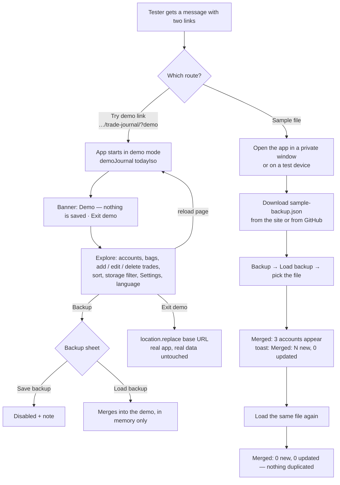
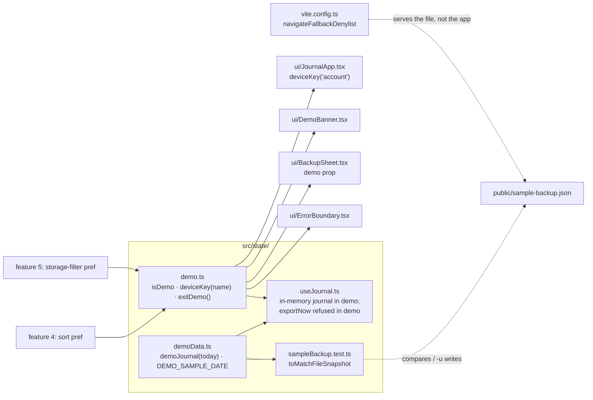

# Demo data — plan

> **Status:** Planned · **Owner:** @stanislavSav · **Decided:** 2026-10-12
> **Vocabulary:** [docs/CONTEXT.md](../CONTEXT.md) (Demo mode, Backup, Device preference, Storage tag) ·
> **Decisions:** [docs/README.md](../README.md) G4, G5, G6, G7 · **Depends on:** features 1–5, especially
> [i18n](../i18n/plan.md) (Settings sheet, `useT()`) and [storage tags](../storage-tags/plan.md) ·
> **Tasks:** [tasks/](tasks/README.md) · **Parking lot:** [parking-lot/](parking-lot/README.md)

## 1. Why

The owner wants "testing data that can be handed to a person so he can test how the app works". Today a new person
opens an empty app with one account `CS` and must type trades before anything interesting shows: no open and closed
bags, no P/L, no warnings, no storage tags. The only sample data is a small dev-only set that works in `npm run dev`
and never on the live site (`src/state/demo.ts:4-5`, `import.meta.env.DEV`).

After this feature there are two ways to try the app. (a) A **"Try demo" link**, `…/trade-journal/?demo`, opens the live
app with rich sample data. A banner says "Demo — nothing is saved", nothing is written to the tester's real data, and
"Exit demo" goes back to the real app. (b) A **sample backup file**, `sample-backup.json`, that a tester loads with
Load backup, for example in a private window, to test backups and merging. Both come from the same demo journal.

## 2. Scope

**In:**

- `?demo` works in production builds, not only in `vite dev`.
- A richer, **deterministic** demo journal: 3 accounts, 15 bags, open and closed, partial sells, a trade with an
  unknown date, a coin without a live price, an oversold warning, storage tags (single, mixed, none, custom).
- Trade dates relative to "today" in the live demo; a fixed reference date for the sample file and tests.
- A demo banner (EN + UK) with **Exit demo**; a "Demo" mark on the bag screen.
- Device preferences in demo use their own key prefix `trade-journal:demo:ui:` (account, sort, storage filter).
- Backup sheet and crash screen behave safely in demo (Save disabled, Load merges into the demo only).
- `public/sample-backup.json`, generated from the demo journal; a test fails when it drifts.
- A service-worker rule so the sample file URL serves the file, not the app.
- README "How to test" section (both routes, the merge warning).

**Out, deliberately:**

- Demo content in Ukrainian. Demo data is stored data and stays English in both UI languages; the UI around it is
  translated ([parking lot](parking-lot/01-demo-content-language.md)).
- A "Try demo" button inside the app, and a download link for the sample file inside the app
  ([parking lot](parking-lot/02-in-app-demo-entry.md)). The links live in the README and in shared messages.
- A guided tour or coach marks.
- Fake prices. The demo uses live CoinGecko prices like the real app (G7: no new network calls).
- A "reset demo" button. Reloading the `?demo` page resets it, because nothing is saved.
- A `?lang=uk` URL parameter ([parking lot](parking-lot/04-lang-url-parameter.md)).

## 3. Decisions

| #   | Question                                           | Decision |
| --- | -------------------------------------------------- | -------- |
| D1  | Link, file, or both?                               | **Both** (owner decision). One source: `demoJournal()`. |
| D2  | Does `?demo` work on the live site?                | Yes. `isDemo` = `new URLSearchParams(location.search).has('demo')`, no `import.meta.env.DEV` check (`src/state/demo.ts:4-5`). Computed once at start; leaving demo is a page load. The demo code ships in the main bundle (a few KB). |
| D3  | What does "nothing is saved" mean exactly?         | In demo the app never reads or writes `trade-journal:journal:v1`, `…:unreadable` or `trade-journal:backup`. The journal lives in memory (already true: `src/state/useJournal.ts:38,47,93`). It does not call `requestPersistence` (Firefox may show a prompt). **Allowed writes:** keys under `trade-journal:demo:`, `trade-journal:ui:lang` (D6), and the shared price cache `trade-journal:prices` (public CoinGecko prices only; extra coins in it do no harm). |
| D4  | How does the tester know it is a demo?             | A banner at the top of the list screen, above the header: **"Demo — nothing is saved · Exit demo"** / **"Демо — нічого не зберігається · Вийти з демо"**. On the bag screen, a small **Demo** chip in the top bar. Both come from the catalogs (G4). |
| D5  | What does **Exit demo** do?                        | `location.replace(import.meta.env.BASE_URL)`: loads the real app without `?demo`, and the demo page is not left in history. The tester's real data appears untouched. |
| D6  | Device preferences in demo                         | One helper `deviceKey(name)` returns `trade-journal:ui:<name>` normally and `trade-journal:demo:ui:<name>` in demo. Used for `account` (`src/ui/JournalApp.tsx:44`), the sort order (feature 4) and `storage-filter` (feature 5, `docs/storage-tags/plan.md` D3). **Exception: language** keeps the real key `trade-journal:ui:lang`, because it belongs to the person, not to the portfolio; a tester who switches to Українська in the demo expects the real app in Українська too. Owner to confirm: [parking lot](parking-lot/02-language-shared-in-demo.md). |
| D7  | Backup sheet in demo                               | **Save backup is disabled**, with the note "This is the demo. There is nothing to back up. Exit the demo to back up your own data." This also fixes a real bug: today `exportNow` in demo calls `exportBackup`, which writes the **real** `lastBackupAt` (`src/storage/index.ts:138`, `src/state/useJournal.ts:70-74`) and can hide the "not backed up" dot of the tester's real data. **Load backup works** and merges the file into the demo journal in memory, so a tester can try loading without risk; the help text says so. |
| D8  | Settings sheet in demo                             | Same as normal: language switch and About work. Account removal (feature 3) works on the in-memory demo journal. No extra demo section. |
| D9  | Crash screen in demo                               | The crash screen (`src/ui/ErrorBoundary.tsx:22-52`) hides "Save backup" (it would export the real journal, not what the tester saw) and shows **Reload** and **Exit demo**. |
| D10 | Dates: relative or fixed?                          | **Both, from one function.** `demoJournal(today: string)` places every trade "N days before `today`" (or on an unknown date). The live demo passes `todayIso()`, so it never looks stale. The sample file and the tests pass the fixed `DEMO_SAMPLE_DATE` (`'2026-10-01'`), so they are deterministic. No trade is ever after `today`. |
| D11 | Ids and timestamps                                 | Fixed, readable ids: `demo-family` style account ids, `demo-bag-01` … `demo-bag-15`, `demo-trade-001` …, custom storage `demo-storage-family-safe`. `createdAt` / `updatedAt` are computed from the reference date and the row order. So: (1) the sample file is byte-stable for the drift test; (2) loading the sample file twice adds nothing (same ids, same `updatedAt`, G6); (3) a tester's later edits to sample trades win the merge (newer `updatedAt`). When the demo data changes, **move `DEMO_SAMPLE_DATE` forward**, so the new sample's records win over an older loaded copy. |
| D12 | Account names                                      | `Demo`, `Demo Family`, `Demo Swing` (ids `demo`, `demo-family`, `demo-swing`). Account ids are name slugs (`src/domain/journal.ts:4-10`), so a sample account named `Family` would **merge into a tester's real `Family` account**. The `Demo` prefix avoids that. The sample never contains the default account `cs`. |
| D13 | Demo content                                       | §6.2 table: 15 bags in 3 accounts. Every case the UI can show appears at least once. Numbers are made up and plausible. Only one trade has a note: the coin without a price ("Demo data, not a real trade"). |
| D14 | Sample file                                        | `public/sample-backup.json` (served at `/trade-journal/sample-backup.json`). The name does not match `.gitignore`'s `trades*.json`, so it is committed. Content: `JSON.stringify(demoJournal(DEMO_SAMPLE_DATE), null, 2)` plus a final newline, the same shape as a real backup (`src/storage/index.ts:123`). |
| D15 | How is the sample file kept in step?               | A Vitest test `src/state/sampleBackup.test.ts` does `await expect(json).toMatchFileSnapshot('../../public/sample-backup.json')`. `npm test -- -u` regenerates it. In CI (`process.env.CI`), Vitest never writes snapshots and fails on a mismatch, so a drifted file fails the deploy (`.github/workflows/deploy.yml` runs `npm test`). The same test checks that `parseJournal` accepts the file. No separate script. |
| D16 | Service worker and the sample file                 | **Not precached**: `globPatterns` is `**/*.{js,css,html}` (`vite.config.ts:37`) and `includeAssets` lists only two icons, so no user downloads it in the background. **But** `navigateFallback: 'index.html'` (`vite.config.ts:38`) answers every in-scope navigation with the app shell, so a person who has the PWA and opens the sample URL in the address bar would get the app, not the file. Add `navigateFallbackDenylist: [/\/sample-backup\.json$/]` to the Workbox options. The README also links to the file on GitHub, where no service worker runs. |
| D17 | `?demo` and the service worker                     | `?demo` is a navigation to the app's own URL, so `navigateFallback` serves the precached `index.html` and the demo opens **offline** too (prices then come from the cache or show "no prices yet"). Task 04 checks this on a device. |
| D18 | Installing the app from the demo page              | The manifest `start_url` is `/trade-journal/` without `?demo` (`vite.config.ts:23`), so Chrome / Android / desktop installs always open the real app. iOS may use the current page URL for "Add to Home Screen"; if so, the installed icon opens the demo, and the banner's Exit demo leads out. Device check: [parking lot](parking-lot/04-ios-home-screen-from-demo.md). |
| D19 | Language of demo content                           | English (account, bag and custom storage names, the one note), in both UI languages. Stored data is never translated (i18n plan D10), and one sample file serves everyone. [Parking lot](parking-lot/01-demo-content-language.md). |
| D20 | README                                             | A "How to test" section (in the "Try it" place that feature 1 leaves, `docs/open-source/plan.md` §5): the demo link, the sample file, and a warning that **loading the sample file merges it into your real data**; use a private window or the demo link. How to remove it again: Settings → Accounts → remove the three `Demo…` accounts (feature 3). |

**Defaults decided without a question** (reversible; flag in review if wrong):

- The banner scrolls away with the header (the header is not sticky today, `src/ui/styles.css` `.app-header`). It
  shows at every start and every return to the top; Backup and the crash screen repeat the message where it matters.
- Demo device preferences persist in `localStorage` under the demo prefix (not `sessionStorage`), so a tester's demo
  sort order survives a reload. They never touch the real ones.
- Live prices are on in the demo. If CoinGecko is slow or offline, the demo still works (the "no price" states are
  part of what it shows).
- The `isDemo` constant stays a module constant (no React state): leaving demo always reloads the page.
- From this feature on, **every new feature that adds data extends `demoJournal()`** and regenerates the sample file
  (rule in [tasks/README.md](tasks/README.md)).

## 4. User flow



## 5. Screens

No interactive mockup. The wireframes below are the contract.

### 5.1 Demo banner (list screen)

```
┌────────────────────────────────────────┐
│ ┌────────────────────────────────────┐ │
│ │ Demo — nothing is saved  Exit demo │ │  .banner style, neutral (accent) colours, not the
│ └────────────────────────────────────┘ │  red error colour; "Exit demo" is a text button
│ [Demo] Demo Family  Demo Swing +  ⚙ Backup│
│ ┌────────────────────────────────────┐ │
│ │ Value                    $48,210   │ │
│ │ …                                  │ │

Ukrainian:
│ │ Демо — нічого не зберігається      │ │  wraps to two lines on narrow phones;
│ │                        Вийти з демо │ │  the button stays right-aligned
```

- `role="status"` is **not** used (it would be announced on every start); it is a plain region with a heading-free
  text and a button.
- No red "unsaved" dot on Backup in demo (already true: `unsaved` is false in demo, `src/state/useJournal.ts:113`).

### 5.2 Bag screen top bar in demo

```
┌────────────────────────────────────────┐
│ ‹ Demo                          [Demo] │  back button as today; small neutral chip at the right
│ BTC  Open                              │
│ Long-term                       Rename │
```

### 5.3 Backup sheet in demo

```
┌────────────────────────────────────────┐
│ Backup                           Close │
│ ┌────────────────────────────────────┐ │
│ │ This is the demo. There is nothing │ │
│ │ to back up. Exit the demo to back  │ │
│ │ up your own data.                  │ │
│ │ [        Save backup        ]      │ │  disabled
│ └────────────────────────────────────┘ │
│ ┌────────────────────────────────────┐ │
│ │ [        Load backup        ]      │ │  works
│ │ In the demo, loading merges the    │ │
│ │ file into the demo only. Nothing   │ │
│ │ is saved.                          │ │
│ └────────────────────────────────────┘ │
└────────────────────────────────────────┘
```

### 5.4 Crash screen in demo

```
  Something went wrong
  <error message>
  This was the demo. Your own data was not touched.
  [ Reload ]  [ Exit demo ]
```

## 6. Architecture



### 6.1 Seams

- `isDemo: boolean` (module constant).
- `deviceKey(name: string): string` — **every** device preference key goes through it, except `lang`. Tasks of
  features 4 and 5 that already shipped use `trade-journal:ui:` literals; task 02 replaces them
  (`grep -rn "trade-journal:ui:" src`).
- `exitDemo(): void` — `location.replace(import.meta.env.BASE_URL)`.
- `demoJournal(today: string): Journal` — pure, deterministic for a given `today`, passes `parseJournal`.
- `DEMO_SAMPLE_DATE = '2026-10-01'`.

### 6.2 Demo content (contract for task 01)

"−N" = N days before `today`; "?" = unknown date. Storage ids are examples from the storage-tags catalogue
(`docs/storage-tags/plan.md` §6: predefined lower-case ids such as `binance`, `ledger`); task 01 uses the ids that
really exist in the shipped catalogue and adjusts this table.

| #  | Account     | Coin (geckoId)                | Bag name     | Trades                                           | Storage tags              | Case it shows |
| -- | ----------- | ----------------------------- | ------------ | ------------------------------------------------ | ------------------------- | ------------- |
| 01 | Demo        | BTC (`bitcoin`)               | Long-term    | buy −420, buy −300, buy −120                     | ledger                    | open; average of 3 buys; single tag icon |
| 02 | Demo        | ETH (`ethereum`)              | Main         | buy −360, sell −200 (part), sell −30 (part)      | binance + ledger          | open after partial sells; Mixed |
| 03 | Demo        | SOL (`solana`)                | Unknown date | buy ?, buy −90                                   | —                         | unknown date "?"; No tag |
| 04 | Demo        | BTC (`bitcoin`)               | Swing        | buy −150, sell −110 (all)                        | binance                   | closed with profit; 2nd bag of the same coin |
| 05 | Demo        | DOGE (`dogecoin`)             | Fun          | buy −250, sell −180 (all)                        | binance                   | closed with loss |
| 06 | Demo        | LINK (`chainlink`)            | Oversold     | buy −100 (50), sell −60 (60)                     | binance                   | **warning** "Sold 10 more than held" |
| 07 | Demo        | FAKE (no geckoId)             | Test coin    | buy −40, note "Demo data, not a real trade"      | —                         | **no live price**; note on a trade |
| 08 | Demo Family | BTC (`bitcoin`)               | Kids fund    | 6 monthly buys −180 … −30                        | custom "Family safe" (other) | DCA; custom storage |
| 09 | Demo Family | ETH (`ethereum`)              | Staking      | buy −300                                         | ledger                    | one trade |
| 10 | Demo Family | ADA (`cardano`)               | DCA          | 5 small buys −150 … −10                          | binance                   | many small buys |
| 11 | Demo Family | XRP (`ripple`)                | Two sells    | buy −280, sell −200 (40 %), sell −140 (60 %)     | binance                   | closed through partial sells |
| 12 | Demo Swing  | HYPE (`hyperliquid`)          | Breakout     | buy −45, buy −20                                 | a hot wallet              | recent, open |
| 13 | Demo Swing  | PEPE (`pepe`)                 | Meme         | buy −75 (huge qty, tiny price)                   | binance                   | tiny price format (`0.00001234`) |
| 14 | Demo Swing  | SOL (`solana`)                | Breakout     | buy −130, sell −125 (all)                        | a DEX                     | closed with loss; same coin as #03 in another account |
| 15 | Demo Swing  | TON (`the-open-network`)      | Airdrop      | buy −35, sell ? (half)                           | a hot wallet              | open; date range "dd.mm.yy – ?" |

Totals: 3 accounts, 15 bags (10 open, 5 closed by design: #04, #05, #06, #11, #14), about 40 trades, 1 custom storage.
The task checks the gecko ids against CoinGecko once (they are the ids the app's search returns today).

### 6.3 Data model

No change. The demo journal and the sample file use the journal shape as it is when this feature starts (including
`Bag.storageIds` and `Journal.storages` from feature 5, and `version: 1`).

## 7. Libraries

| Need                          | Choice                                | Licence | Why |
| ----------------------------- | ------------------------------------- | ------- | --- |
| Keep the sample file in step  | Vitest `toMatchFileSnapshot` (already a dev dependency, Vitest 5) | MIT | No script and no extra tool; `-u` regenerates; CI fails on drift. |
| Exclude the file from the SW fallback | Workbox `navigateFallbackDenylist` via vite-plugin-pwa (already used) | MIT | One line in `vite.config.ts`. |

## 8. Constraints that shape the design

- **`addTrade` makes random ids** (`src/domain/actions.ts` `newId()` → `crypto.randomUUID()`), so today's
  `demoJournal()` (`src/state/demo.ts:23-53`) is different on every call and cannot back a file snapshot. Task 01
  builds records with fixed ids (or remaps ids after building).
- **Account ids are name slugs** (`src/domain/journal.ts:4-10`); a sample account with a common name merges into a
  real one (D12).
- **Merge rule**: the higher `updatedAt` wins; ties keep the device's copy (`src/domain/journal.ts:133-150`). Sample
  timestamps must be older than anything a tester does after loading, and must grow when the sample changes (D11).
- **Today's demo writes a real key**: `exportNow` → `exportBackup` → `writeBackupState` (`src/storage/index.ts:138`).
  D7 fixes it.
- **`useStoredString('trade-journal:ui:account')`** (`src/ui/JournalApp.tsx:44`) would overwrite the tester's real
  account choice with `demo` today (D6).
- **The crash screen exports `loadJournal()`** (`src/ui/ErrorBoundary.tsx:27`), which is the real journal (D9).
- **The service worker's navigation fallback** catches any in-scope navigation (`vite.config.ts:38`) (D16, D17).
- **`.gitignore` ignores `trades*.json`**; the sample name must not match (D14).
- **Tests run in Node** (`vite.config.ts:51`): `toMatchFileSnapshot` resolves the path relative to the test file.
- **`history.pushState` keeps the query string** (`src/ui/route.ts`, `pushState(…, '')`), so `?demo` survives opening
  and closing bags.

## 9. Risks

| Risk                                                                      | Likelihood | Impact | Mitigation |
| ------------------------------------------------------------------------- | ---------- | ------ | ---------- |
| A tester loads the sample file into their real data by mistake            | Medium     | Medium | README warning; `Demo…` account names; fixed ids (loading twice adds nothing); removal through feature 3. |
| Demo writes a real key (now or after a later feature adds a preference)  | Medium     | High   | `deviceKey()` as the only way to build a preference key; task 02 manual Local Storage check; rule in tasks/README. |
| Sample file drifts from the demo journal                                  | Medium     | Low    | Snapshot test fails in CI (D15). |
| Address-bar visit to the sample URL shows the app instead of the file     | High without D16 | Medium | `navigateFallbackDenylist` (D16); GitHub link in README. |
| Demo looks stale or has future dates                                      | Low        | Low    | Relative dates (D10); test: no trade after `today`. |
| iOS home-screen icon added from the demo opens the demo                   | Medium     | Low    | Banner + Exit demo; device check ([parking lot](parking-lot/04-ios-home-screen-from-demo.md)). |
| Live prices make demo P/L look odd (huge loss or gain)                    | Medium     | Low    | Choose buy prices near long-run averages; P/L variety is part of the demo. |
| A CoinGecko id in the demo is wrong or disappears                         | Low        | Low    | The bag shows "no price", which the app handles; task 01 checks ids once. |

## 10. Rollout

- No flag. Commits to `main`; the deploy workflow tests, builds and publishes.
- Order: task 01 (data) → 02 (demo on production) → 03 (sample file + SW rule) → 04 (README and device checks).
  After task 02 the link works on the live site; announce it only after task 04.
- Verification: `npm test`, `npm run typecheck`, `npm run build`, and the manual checks in each task (Local Storage
  before / after, offline `?demo`, sample download, load twice).
- Rollback: revert. Demo keys (`trade-journal:demo:*`) left on devices are harmless; nothing reads them without
  `?demo`. The sample file is a static file; removing it breaks only README links.

## 11. Open, deliberately

- In-app entry points ("Try demo", "Download sample backup"): [parking lot](parking-lot/02-in-app-demo-entry.md).
- `?demo&lang=uk` links for the Ukrainian community: [parking lot](parking-lot/04-lang-url-parameter.md).
- README screenshots from demo data: the open-source feature waits for sample data
  (`docs/open-source/plan.md` §11); after this feature, screenshots can be taken from `?demo`.
- A branded copy (whitelabel) can use the `?demo` link as its clickable example.

Questions that come up while building go to [parking-lot/](parking-lot/README.md), one file each (template:
`docs/_templates/parking-lot.md`).
