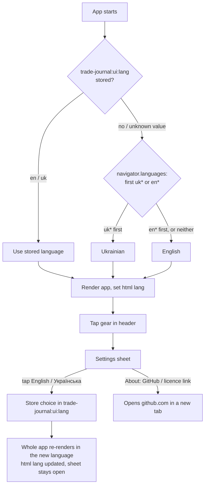
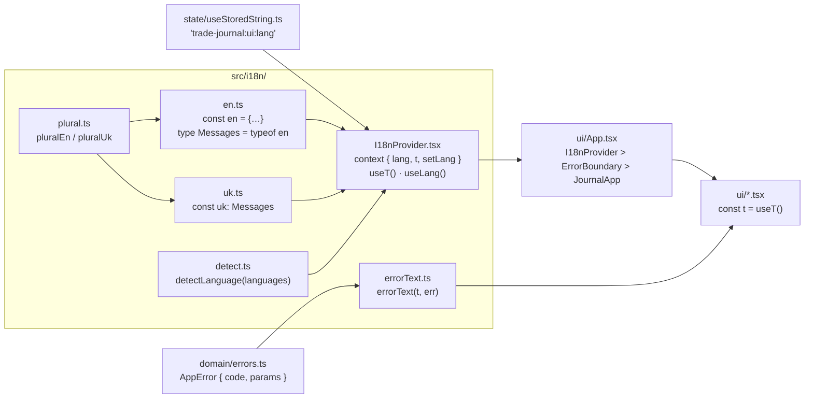

# Ukrainian / English (i18n) — plan

> **Status:** Planned · **Owner:** @stanislavSav · **Decided:** 2026-10-12
> **Vocabulary:** [docs/CONTEXT.md](../CONTEXT.md) · **Decisions:** [docs/README.md](../README.md) G4, G5, G6, G7 ·
> **Tasks:** [tasks/](tasks/README.md) · **Parking lot:** [parking-lot/](parking-lot/README.md)

## 1. Why

The app is English only. A Ukrainian crypto community may use a branded copy of it (whitelabel), and the owner is
Ukrainian. Many people in that community read English slowly, and a money app that they cannot read with confidence is
an app they do not trust with their trades.

After this feature, every screen, button, hint, error and toast exists in **English and Ukrainian**. On first launch the
app follows the device language. A new **Settings** sheet (gear button next to Backup) lets the user switch the
language at any time, and shows an About section (version, source code, licence, "your data stays on this device").
From this feature on, every new UI string is added in both languages (G4).

## 2. Scope

**In:**

- Typed message catalogs `src/i18n/en.ts` (the source) and `src/i18n/uk.ts`. TypeScript fails the build when a key is
  missing or extra in `uk.ts`.
- A `useT()` hook (React context), plurals with `Intl.PluralRules`, language detection, the device preference
  `trade-journal:ui:lang`, and `<html lang>` that follows the UI language.
- The **Settings sheet**: Language (English / Українська) and About. Later features add their own sections to it
  (feature 3 adds account removal).
- Every user-visible string in `src/ui/*.tsx` and `src/ui/formValues.ts`, including `aria-label`, `title`, placeholders,
  toasts and the crash screen.
- Messages that today are English sentences built outside the UI become **data** (codes and numbers), and the UI
  translates them: domain errors (`src/domain/actions.ts`), backup parse errors (`src/domain/journal.ts`), storage
  errors (`src/storage/index.ts`), bag warnings (`src/domain/portfolio.ts:68`), price and coin-search errors
  (`src/prices/index.ts`, `src/ui/useCoinSearch.ts`).
- New default bag names in the UI language (D11).
- Tests: identical key sets, no empty values, plural forms, language detection.

**Out, deliberately:**

- **Stored data is never translated** (D10): account names, bag names, coin names, notes and the contents of
  `trades.json` stay as the user typed or stored them.
- An i18n library (react-intl, i18next, lingui). Two languages and ~190 strings do not need one (D2).
- Localized number and currency format. Numbers stay `$1,234.56` in both languages (D8, owner decision 2026-10-12,
  [parking lot](parking-lot/03-number-format-in-ukrainian.md)).
- A Ukrainian PWA manifest or `index.html`. The manifest is one language per build (D14).
- A Ukrainian README. The README stays English (see [docs/open-source/plan.md](../open-source/plan.md)).
- More languages. The design allows a third catalog, but nobody asked for one.
- Brand-specific default language for a branded copy (whitelabel; planned outside this repo, see §11).

## 3. Decisions

| #   | Question                                        | Decision |
| --- | ----------------------------------------------- | -------- |
| D1  | Which languages?                                | English (source language) and Ukrainian. Owner decision, G4. |
| D2  | Library or hand-made?                           | **No library.** `src/i18n/en.ts` exports `en`; `type Messages = typeof en`; `src/i18n/uk.ts` exports `uk: Messages`. A missing key, an extra key or a wrong parameter type in `uk.ts` is a TypeScript error, so `npm run typecheck` and `npm run build` fail. Both catalogs are bundled (a few KB each); no lazy loading. |
| D3  | Shape of a message                              | A nested object grouped by screen (`t.backup.save`, `t.trade.qtyLabel`). A value is a plain `string`, or a function with named parameters that returns a string: `bought: (p: { qty: string; symbol: string }) => \`Bought ${p.qty} ${p.symbol}\``. No `{placeholder}` parser, no HTML inside messages. Numbers are formatted by the caller (`formatQty`, `formatUsd`) and passed in as strings. |
| D4  | Plurals                                         | `Intl.PluralRules`. Helpers `pluralEn({ one, other })` and `pluralUk({ one, few, many, other })` each return `(n: number) => string`. Ukrainian needs one / few / many (1 нова, 2 нові, 5 нових, 21 нова, 11 нових). Plurals are used only for **whole counts** (trades merged, bags without price). Coin quantities are decimals and never go through a plural. _Note (task 04): "1 of 4 without price" / «1 з 4 без ціни» does not change with the count in either language, so only the merge toast uses a plural._ |
| D5  | Language on first launch                        | Walk `navigator.languages` (fallback `navigator.language`) in order; the first entry that starts with `uk` gives Ukrainian, the first that starts with `en` gives English; none of them gives English. So `["ru-RU", "uk-UA"]` gives Ukrainian and `["de-DE", "en-US"]` gives English. While the user has not chosen, the app keeps following the device. Russian-only devices: [parking lot](parking-lot/01-russian-language-devices.md). |
| D6  | Where is the choice stored?                     | Device preference (G5): `localStorage` key `trade-journal:ui:lang`, value `"en"` or `"uk"`. Written **only** when the user picks a language in Settings. Not in backups. Read and written through the existing guarded `useStoredString` (`src/state/useStoredString.ts`), so private mode still works for the session. An unknown stored value is ignored (device language is used). |
| D7  | Where does the switch live?                     | A new **Settings sheet**, opened by a gear button in the header, left of Backup (`src/ui/Header.tsx:42-50`). Sections: **Language** (segmented control: `English` · `Українська`, each written in its own language) and **About**. The switch applies at once, no reload. Feature 3 adds an Accounts section to this sheet. |
| D8  | Numbers and USD                                 | **Keep today's format in both languages:** `$1,234`, `$12.34`, `+6.7%`, `0.03457`, comma thousands, dot decimals, U+2212 minus (`src/domain/format.ts:8,31,42`). Reasons: the amounts are US dollars; exchanges, CoinGecko and Telegram channels show crypto prices this way; the input parser already accepts both `0,5` and `0.5` (`src/ui/numbers.ts:19-40`); and `format.ts` keeps its 40+ tests unchanged. The `'en-US'` locale moves into one constant in `format.ts` and `numbers.ts`, so a later change is one line. **Owner decision (2026-10-12): `$1,234.56` stays in both languages**; no Ukrainian-style `1 234,56 $` ([parking lot](parking-lot/03-number-format-in-ukrainian.md)). |
| D9  | Dates and times                                 | Keep `DD.MM.YY` (`src/domain/format.ts:53-61`) and 24-hour `HH:MM` (`src/ui/time.ts`). This is already the normal Ukrainian format, so dates need no translation. One fix: the price error text uses the **device** locale today (`src/prices/index.ts:105-110`, `toLocaleString(undefined, { month: 'short' })`), which can mix languages ("Oct 12" in a Ukrainian UI). It switches to the neutral `formatStamp` (`src/ui/time.ts:17`). Month names appear only in default bag names (D11). |
| D10 | Stored data                                     | Never translated: account names (the first-run account `CS`, `src/domain/journal.ts:13-15`), bag names (including old defaults like `Jun 26`), coin names from CoinGecko, notes, and everything in `trades.json`. The backup file name stays `trades.json` in both languages (`src/storage/index.ts:13`), because the help text, the README and `.gitignore` (`trades*.json`) depend on it. |
| D11 | Default name of a **new** bag                   | Follows the UI language **at creation time**, then it is stored data and never changes. `defaultBagName(date, months)` gets the month list as a parameter (default: English, so the domain stays language-free and its tests keep passing). English `Jun 26`, Ukrainian `Черв 26`; no date: `New` / `Нова` (feminine, agrees with «позиція», D18). The placeholder in the "New bag…" name field (`src/ui/AddTradeSheet.tsx:158`) shows the same text. The exact Ukrainian abbreviations wait for the owner: [parking lot](parking-lot/03-default-bag-name-language.md). |
| D12 | Domain errors (thrown `Error`s)                 | **Error codes, translated at the UI edge.** A small `AppError extends Error` in `src/domain/errors.ts` carries `code` and `params`. Its `message` stays the current English text, so logs and the existing `toThrow('…')` tests keep working. The UI calls `errorText(t, err)` (`src/i18n/errorText.ts`): an `AppError` gets its translated text; any other error gets the translated "Something went wrong" plus the raw message. Codes cover `src/domain/actions.ts` (11 throws), `src/domain/journal.ts` (backup parse), and `src/storage/index.ts` (save, share, read file, JSON). |
| D13 | Backup parse errors (Load backup)               | A translated **headline** plus the English technical **detail** in smaller text. Three headlines: "This file is not a Trade Journal backup", "This backup is from a newer version of the app (version N)", "The backup file is damaged". Detail example: `Trade 3: qty must be a positive number`. The detail is for debugging and for a bug report, so it is not translated. _Note (task 04): this is the one planned change of **English** wording. The same headline-plus-detail form now also shows a failed share sheet ("Could not open the share sheet" + the browser's reason) and any error without a code ("Something went wrong" + its message)._ |
| D14 | PWA manifest and `index.html`                   | **English, one language per build.** `name: 'Trade Journal'`, `short_name: 'Trades'`, `lang: 'en'` stay (`vite.config.ts:20-28`), and so do `<title>Trades</title>` and the meta description (`index.html:6-7`). A manifest cannot change language at runtime; "Trades" under the home-screen icon is a name, not a sentence. `<html lang>` (`index.html:2`) is set at runtime to the UI language (D15). A branded build (whitelabel) would set its own manifest. |
| D15 | `<html lang>`                                   | The i18n provider sets `document.documentElement.lang` to `en` or `uk` before the first paint and on every switch. Screen readers then use the right voice. |
| D16 | Warnings, price errors, search errors           | Become data: `BagSummary.warnings` changes from `string[]` to `BagWarning[]` (`{ kind: 'oversold', qty, date }`, `src/domain/types.ts:74`, `src/domain/portfolio.ts:68`). `PriceSnapshot.error` changes from `string` to `PriceProblem \| null` (`{ kind: 'offline' \| 'rateLimited' \| 'http' \| 'badResponse' \| 'failed', status? }`). `searchCoins` throws `AppError` with search codes. The UI writes the sentence. _Note (task 03): `useCoinSearch` adds two codes: `deviceOffline` ("Offline", when the browser says it is offline) and `searchFailed` ("Search failed", for an error without a code, which before showed its raw message)._ |
| D17 | Address form in Ukrainian                       | **Polite Ви forms** (owner decision 2026-10-12), and imperative forms that avoid the pronoun where possible ("Введіть…", "Натисніть ще раз…", "Ваші угоди…"). No "ти" forms. In UI text the pronoun has a capital letter only at the start of a sentence. [Parking lot](parking-lot/04-formal-or-informal-address.md). |
| D18 | Word choices                                    | The glossary in §8.1 is the contract for translators. Decided by the owner on 2026-10-12: **Bag = «Позиція»** (feminine: «Нова позиція…», «Відкриті / Закриті позиції», badge «Відкрита» / «Закрита») and **Account = «Портфель»** (masculine: «Портфелі», «Додати портфель», «Немає портфелів»). «Рахунок» and «Акаунт» are not used for an account. The terms still marked "?" in §8.1 wait for the owner: [glossary](parking-lot/04-glossary-confirmation.md). Records: [Bag](parking-lot/04-term-for-bag.md), [Account](parking-lot/04-term-for-account.md). |

**Defaults decided without a question** (reversible; flag in review if wrong):

- The i18n provider wraps the `ErrorBoundary` in `src/ui/App.tsx`, so the crash screen is translated too.
- `P/L` stays in Latin letters in both languages (crypto people say "PnL"); see the glossary item.
- Coin symbols (BTC), the asset placeholder `BTC, SOL, Hyperliquid…`, the app name `Trade Journal`, `CoinGecko`,
  `GitHub`, `iCloud Drive` and `MIT` are not translated.
- Lists in sentences ("Enter asset, qty and total", `src/ui/AddTradeSheet.tsx:47-50`) use `Intl.ListFormat` in the UI
  language instead of a hard-coded `and` (`src/i18n/joinList.ts`). English uses the `en-GB` list style, because `en`
  adds a comma before "and" ("asset, qty, and total") and the app never wrote that comma.
- The version shown in About comes from `package.json` through Vite `define` (`__APP_VERSION__`), declared in a
  `.d.ts` file. No runtime fetch.
- Native controls (the date picker, `<select>` popups, the iOS share sheet) follow the **device** language, not the app
  language. The app cannot change this; it is noted in §8.
- Both catalogs ship in the main bundle. They are small (about 6–10 KB each before gzip).

## 4. User flow



## 5. Screens

No interactive mockup for this feature. The wireframes below are the contract.

### 5.1 Header with the gear button

```
┌────────────────────────────────────────┐
│ [CS] Family  +              ⚙  Backup• │   gear = icon button, 44×44, aria-label "Settings" / "Налаштування"
└────────────────────────────────────────┘   Ukrainian: [CS] Family  +   ⚙  Бекап•
```

- The gear sits between the account bar and the Backup button. It never hides; the account tabs scroll as today
  (`src/ui/styles.css` `.account-tabs`, `overflow-x: auto`).
- The red dot stays on Backup only.

### 5.2 Settings sheet (English)

```
┌────────────────────────────────────────┐
│ ▔▔▔▔▔                                   │
│ Settings                         Close │   Sheet (src/ui/Sheet.tsx)
│                                        │
│ LANGUAGE                               │
│ ┌────────────────────────────────────┐ │
│ │  [ English ]  [ Українська ]       │ │   segmented control, role=radiogroup;
│ └────────────────────────────────────┘ │   each option in its own language
│ Until you choose, the app follows the  │   hint shown only while nothing is stored
│ language of this device.               │
│                                        │
│ (feature 3 adds ACCOUNTS here)         │   order: Language, Accounts, About
│                                        │
│ ABOUT                                  │
│ ┌────────────────────────────────────┐ │
│ │ Trade Journal               0.1.0  │ │   version from package.json
│ │ Your data stays on this device.    │ │
│ │ No account, no server, no          │ │
│ │ tracking. Prices come from         │ │
│ │ CoinGecko.                         │ │
│ ├────────────────────────────────────┤ │
│ │ Source code on GitHub            ↗ │ │   github.com/stanislavSav/trade-journal
│ ├────────────────────────────────────┤ │
│ │ MIT licence                      ↗ │ │   …/blob/main/LICENSE (added by feature 1)
│ └────────────────────────────────────┘ │
└────────────────────────────────────────┘
```

### 5.3 Settings sheet (Ukrainian)

```
┌────────────────────────────────────────┐
│ Налаштування                   Закрити │
│ МОВА                                   │
│ │  [ English ]  [ Українська ]       │ │
│ Поки ви не оберете, застосунок         │
│ використовує мову цього пристрою.      │
│ ПРО ЗАСТОСУНОК                         │
│ │ Trade Journal               0.1.0  │ │
│ │ Ваші дані зберігаються лише на     │ │
│ │ цьому пристрої. Без облікового     │ │
│ │ запису, без сервера, без стеження. │ │
│ │ Ціни — з CoinGecko.                │ │
│ │ Вихідний код на GitHub           ↗ │ │
│ │ Ліцензія MIT                     ↗ │ │
└────────────────────────────────────────┘
```

The Ukrainian wording above is a proposal. The owner confirms it with the glossary. "No account" here means "no
login", so it is «без облікового запису», not «портфеля» (Account = «Портфель», D18).

## 6. Architecture



**Seams** (other code depends on these):

- `useT(): Messages` — the only way UI code gets text. `useLang(): { lang: Lang; setLang(l: Lang): void }` for Settings
  and for `defaultBagName`'s month list.
- `type Lang = 'en' | 'uk'`.
- `AppError` (`src/domain/errors.ts`): `code: ErrorCode` (a string union) and `params: Record<string, string | number>`.
  Domain, storage and prices throw it; only the UI turns it into text.
- `errorText(t, err): { text: string; detail?: string }` — one function for every `catch` in the UI
  (`AddTradeSheet.tsx:121`, `AddAccountSheet.tsx:27`, `BagName.tsx:31`, `EditTradeSheet.tsx:46`,
  `BackupSheet.tsx:16`, `ErrorBoundary.tsx:29,32`, `useJournal.ts:52`).
- `BagWarning`, `PriceProblem` types in `src/domain/types.ts` and `src/prices/index.ts`.

**Data model:** no change to the journal or to backups. One new device preference key, `trade-journal:ui:lang`.

**Catalog layout** (top-level groups; each group maps to one screen or component):

```ts
export const en = {
  common: { save, cancel, close, rename, back, somethingWrong, … },
  header: { accounts, addAccount, settings, backup, backupUnsaved },
  summary: { label, value, openPl, realized, withoutPrice: (p) => …, pricesAt: (p) => …, noPrices, refresh, refreshing },
  list: { bags, open, closed, emptyOpen, emptyClosed, noPrice, avg, hasWarnings },
  bag: { open, closed, noLivePrice, holding, avgCost, cost, price, value, unrealized, invested, proceeds, realized,
         dates, checkTrades, oversold: (p) => …, buyMore, sell, trades, nameLabel },
  trade: { addTitle, editTitle: (p) => …, side, buy, sell, account, asset, …, months: ['Jan', …], newBag: 'New' },
  account: { title, name, placeholder, exists, add },
  backup: { title, lastBackup, none, changesSince, save, saving, saved, downloaded, iphoneHelp, load, loading,
            loadHelp, merged: (p) => … },
  settings: { title, language, languageHint, about, dataStays, sourceCode, licence },
  crash: { title, stillStored, saveBackup, reload, backupSaved, backupFailed },
  errors: { [code]: string | (p) => string },   // one entry per ErrorCode
  prices: { offline, rateLimited, http: (p) => …, badResponse, failed, showingFrom: (p) => …, noPricesYet },
  search: { searching, unavailable: (p) => …, noCoins, offline, inJournal, suggestions },
}
```

**Existing code reused:** `useStoredString` for the preference; `Sheet` for Settings; `formatStamp` for neutral time
stamps; the `segmented` CSS of the Open/Closed switch (`src/ui/BagList.tsx:24`) for the language switch.

### 6.1 String inventory (October 2026, rough)

| File                              | Strings | Notes |
| --------------------------------- | ------- | ----- |
| `src/ui/AddTradeSheet.tsx`        | ~22     | labels, placeholders, "You hold only …", "No open X bag in Y to sell from", "Enter …" list, toast text comes from JournalApp |
| `src/ui/BagDetail.tsx`            | ~17     | 12 stat labels, Open/Closed badge, "no live price", "Check these trades", Buy more, Sell, Trades |
| `src/ui/EditTradeSheet.tsx`       | ~13     | title with symbol, Unknown/Today chips, Save changes, Tap again to delete, Delete trade |
| `src/ui/BackupSheet.tsx`          | ~12     | status lines, button states, iPhone help, merge help |
| `src/ui/AssetField.tsx`           | ~11     | hints, "in journal", Searching…, "Search unavailable (…)", No coins found |
| `src/ui/JournalApp.tsx`           | ~10     | toasts (Bought/Sold, updated, deleted, Merged), empty state, save-error banner, FAB label |
| `src/ui/SummaryCard.tsx`          | ~9      | labels, "N of M without price", price line, refresh labels |
| `src/ui/AddAccountSheet.tsx`      | ~6      | |
| `src/ui/ErrorBoundary.tsx`        | ~6      | crash screen |
| `src/ui/Header.tsx`               | ~5      | + Settings label (new) |
| `src/ui/BagField.tsx`             | ~5      | "(closed)", "holding … · avg …", New bag… |
| `src/ui/BagList.tsx`              | ~5      | |
| `src/ui/BagName.tsx`              | ~5      | |
| `src/ui/BagRows.tsx`              | ~4      | "avg", "cost · no price", warnings label |
| `src/ui/formValues.ts`            | ~4      | Not a number, Must be more than 0, Date is in the future, "read as …" |
| `src/ui/fields.tsx`               | ~3      | BUY / SELL, "Side" |
| `src/ui/TradeRow.tsx`             | ~2      | BUY / SELL |
| `src/ui/NoteField.tsx`            | ~2      | |
| `src/ui/Sheet.tsx`                | ~1      | Close |
| `src/ui/useCoinSearch.ts`         | ~2      | Offline, Search failed |
| `src/domain/actions.ts`           | 11      | thrown errors → codes (D12) |
| `src/domain/journal.ts`           | ~12     | parse error templates → 3 headlines + English detail (D13) |
| `src/domain/portfolio.ts`         | 1       | oversold warning → `BagWarning` (D16) |
| `src/storage/index.ts`            | 4       | save failed, share sheet, read file, not JSON → codes |
| `src/prices/index.ts`             | ~8      | price and search errors → `PriceProblem` / codes |
| `src/state/useJournal.ts`         | 1       | save error fallback |
| New Settings sheet                | ~12     | |
| **Total**                         | **~190** | |

## 7. Libraries

| Need                     | Choice                                   | Licence | Why |
| ------------------------ | ---------------------------------------- | ------- | --- |
| Message catalogs, lookup | none (TypeScript objects + React context) | —       | Type safety from `typeof en`; zero runtime cost; ~190 strings. |
| Plural rules             | `Intl.PluralRules` (built into browsers) | —       | Correct Ukrainian one/few/many; Safari 13+. |
| Lists ("a, b and c")     | `Intl.ListFormat` (built in)             | —       | Safari 14.1+; correct "і"/"та" in Ukrainian. |

## 8. Constraints that shape the design

- **Tests run in Node, without a DOM** (`vite.config.ts:51`, `environment: 'node'`; no Testing Library in
  `package.json`). i18n tests are pure: catalogs, plural helpers, `detectLanguage`, `errorText`. Screens are checked by
  hand (task 05).
- **Existing tests assert English messages**: `src/domain/actions.test.ts:107-111,164-167,187,200-201,246`,
  `src/domain/journal.test.ts:148-184`, `src/storage/index.test.ts:107,188,231,236`,
  `src/domain/portfolio.test.ts:103,126`, `src/prices/index.test.ts:149,157,165-173,236`. D12 keeps `message` English so
  most stay green; the warning and price tests change with D16.
- **Format functions hard-code `'en-US'`** (`src/domain/format.ts:8,31,42`, `src/ui/numbers.ts:49`). D8 keeps that.
- **The price error uses the device locale** (`src/prices/index.ts:105-110`). D9 fixes it.
- **`defaultBagName` lives in the domain** (`src/domain/actions.ts:23,174-178`) and `addTrade` calls it when no name is
  given (`src/domain/actions.ts:45`). The UI must pass the resolved name (or the month list) so a Ukrainian user gets
  a Ukrainian default name.
- **Native controls follow the device language.** `<input type="date">` (`src/ui/fields.tsx:86-97`) and `<select>`
  popups show the device's language and date order. On iOS the share sheet labels ("Save to Files") are in the device
  language too, which matters for the iPhone help text in Backup ([parking lot](parking-lot/04-iphone-help-text-in-ukrainian.md)).
- **Ukrainian text is longer** (about 20–30 % more letters): "Backup" → "Бекап" fits; "Save changes" → "Зберегти
  зміни"; stat labels in the bag screen grid; the BUY / SELL toggle and badges. Check at 320 px width.
- **Header space is tight** (`src/ui/styles.css` `.app-header`, `.backup-btn`): the gear must be an icon button, not a
  text button.
- **Toasts are announced** (`src/ui/Toast.tsx`, `aria-live="polite"`). With `<html lang="uk">` the screen reader reads
  them in Ukrainian.
- **The service worker auto-updates** (`vite.config.ts:14`, `registerType: 'autoUpdate'`). A user may see one more
  English session after the deploy, then the new build.

### 8.1 Glossary EN → UK (proposal; "?" = owner must confirm; Bag, Account and the Ви form are decided, D17–D18)

| English (UI)                 | Ukrainian (proposal)            | Notes |
| ---------------------------- | ------------------------------- | ----- |
| Trade Journal (app name)     | Trade Journal                   | Name, not translated. |
| Account                      | Портфель                        | Decided 2026-10-12 (masculine). Plural «Портфелі», genitive plural «портфелів». Not «Рахунок», not «Акаунт». [Parking lot](parking-lot/04-term-for-account.md). |
| Accounts (Settings section)  | Портфелі                        | |
| Add account                  | Додати портфель                 | |
| No accounts yet.             | Портфелів поки немає.           | Empty state. |
| Bag                          | Позиція                         | Decided 2026-10-12 (feminine). Plural «позиції», genitive plural «позицій». [Parking lot](parking-lot/04-term-for-bag.md). |
| New bag…                     | Нова позиція…                   | |
| Open / Closed (list tabs)    | Відкриті / Закриті              | Plural, agrees with "позиції". |
| Open / Closed (badge)        | Відкрита / Закрита              | Feminine, agrees with "позиція". |
| Coin / Asset (field label)   | Монета                          | Alternative: Актив. |
| Trade                        | Угода                           | |
| BUY / SELL (toggle, badges)  | КУПІВЛЯ / ПРОДАЖ                | Check the width of the badge at 320 px. |
| Buy more                     | Докупити                        | |
| Sell (button)                | Продати                         | |
| Qty                          | К-сть                           | "Кількість" where there is room. |
| Total $                      | Сума $                          | |
| Price                        | Ціна                            | |
| Holding                      | Залишок                         | Coins still held. |
| Avg cost                     | Сер. ціна                       | Full: "Середня ціна". |
| Average cost (the method)    | Метод середньої ціни            | Docs and About only. |
| Cost                         | Собівартість                    | Cost of the coins still held. |
| Value                        | Вартість                        | |
| Invested                     | Вкладено                        | |
| Proceeds                     | Виручка                         | Alternative: Отримано. |
| Realized (P/L)               | Реалізований P/L ?              | Short label: "Реалізовано". Alternatives: "Зафіксовано", "PnL". |
| Unrealized (P/L)             | Нереалізований P/L ?            | Short label: "Нереалізовано". |
| Open P/L                     | P/L відкритих ?                 | |
| P/L on this sell             | P/L цього продажу ?             | |
| Backup (header button)       | Бекап ?                         | Short slang; fits the header. |
| Backup (sheet title)         | Резервна копія                  | |
| Save backup                  | Зберегти копію                  | |
| Load backup                  | Завантажити копію ?             | "Завантажити" can mean both upload and download; alternative "Відкрити копію". |
| Storage (feature 5)          | Сховище                         | Where coins are kept. |
| Storage tag                  | Мітка сховища                   | |
| CEX / DEX                    | CEX / DEX                       | Hint text: "біржа". |
| Hot wallet / Cold wallet     | Гарячий / Холодний гаманець     | |
| Settings                     | Налаштування                    | |
| Language                     | Мова                            | |
| About                        | Про застосунок                  | "Застосунок" is the standard word; "додаток" is common but a calque. |
| Demo (feature 6)             | Демо                            | |
| no live price                | без актуальної ціни             | |
| Refresh prices               | Оновити ціни                    | |
| Unknown (date)               | Невідома                        | |
| Today                        | Сьогодні                        | |
| Note / Add note              | Нотатка / Додати нотатку        | |
| Rename                       | Перейменувати                   | |
| Save / Save changes          | Зберегти / Зберегти зміни       | |
| Cancel / Close               | Скасувати / Закрити             | |
| Delete trade                 | Видалити угоду                  | |
| Tap again to delete          | Натисніть ще раз, щоб видалити  | Polite Ви form (D17). |
| Check these trades           | Перевірте ці угоди              | |
| Merged: 3 new, 1 updated     | Об'єднано: 3 нові, 1 оновлена   | Plural (D4): 1 нова · 2 нові · 5 нових. |
| Month abbreviations (D11)    | Січ Лют Бер Квіт Трав Черв Лип Серп Вер Жовт Лист Груд ? | [Parking lot](parking-lot/03-default-bag-name-language.md). |

## 9. Risks

| Risk                                                                 | Likelihood | Impact | Mitigation |
| -------------------------------------------------------------------- | ---------- | ------ | ---------- |
| A string is missed and stays English in the Ukrainian UI             | Medium     | Low    | Task 04 greps for string literals in JSX; task 05 walks every screen in Ukrainian. |
| `uk.ts` drifts from `en.ts` when later features add strings          | Medium     | Medium | `uk: Messages` makes a missing key a build error; the key-set test also fails. |
| Ukrainian text overflows buttons, badges or the stats grid           | Medium     | Medium | Task 05 checks every screen at 320 px and 390 px; shorter synonyms from the glossary. |
| Translation sounds wrong to native speakers                          | Medium     | Medium | Glossary and catalog reviewed by the owner (Ukrainian) before release; parked items. |
| Changing `warnings` and `PriceSnapshot.error` types breaks callers    | Low        | Low    | TypeScript finds every caller; tests updated in task 03. |
| A domain error reaches the UI without a code and shows English       | Low        | Low    | `errorText` shows the translated "Something went wrong" headline plus the raw message. |
| Language detection picks the wrong language on a mixed-language phone | Low        | Low    | One tap in Settings fixes it, and the choice is remembered. |

## 10. Rollout

- No flag. Each task is a normal commit to `main`; the deploy workflow (`.github/workflows/deploy.yml`) runs
  `npm test` and `npm run build` and publishes to GitHub Pages.
- Tasks 01–03 change no visible text (English stays English). Task 04 makes Ukrainian complete. Until task 04 is done,
  the Ukrainian option in Settings (task 02) can show untranslated English text; that is acceptable on `main` because
  the owner is the only user, but **do not announce the feature** until task 05 is done.
- Verification per task: `npm test`, `npm run typecheck`, `npm run build`, plus the manual checks in the task.
- Rollback: revert the commits. The stored key `trade-journal:ui:lang` is harmless when nothing reads it. No journal or
  backup data changes in this feature.

## 11. Open, deliberately

- **Brand default language.** A branded copy (whitelabel) may want Ukrainian as the default when the device is neither
  `uk` nor `en`. That plan decides; a build-time `VITE_DEFAULT_LANG` would be enough.
- **A `?lang=uk` URL parameter** for links shared in Telegram. Not needed for this feature; see the demo-data parking
  lot ([docs/demo-data/parking-lot/](../demo-data/parking-lot/README.md)).
- **Roadmap wording:** [docs/README.md](../README.md) says feature 3 brings the "Settings screen". This feature now
  introduces the Settings sheet; feature 3 adds its Accounts section to it.

Questions that come up while building go to [parking-lot/](parking-lot/README.md), one file each (template:
`docs/_templates/parking-lot.md`).
