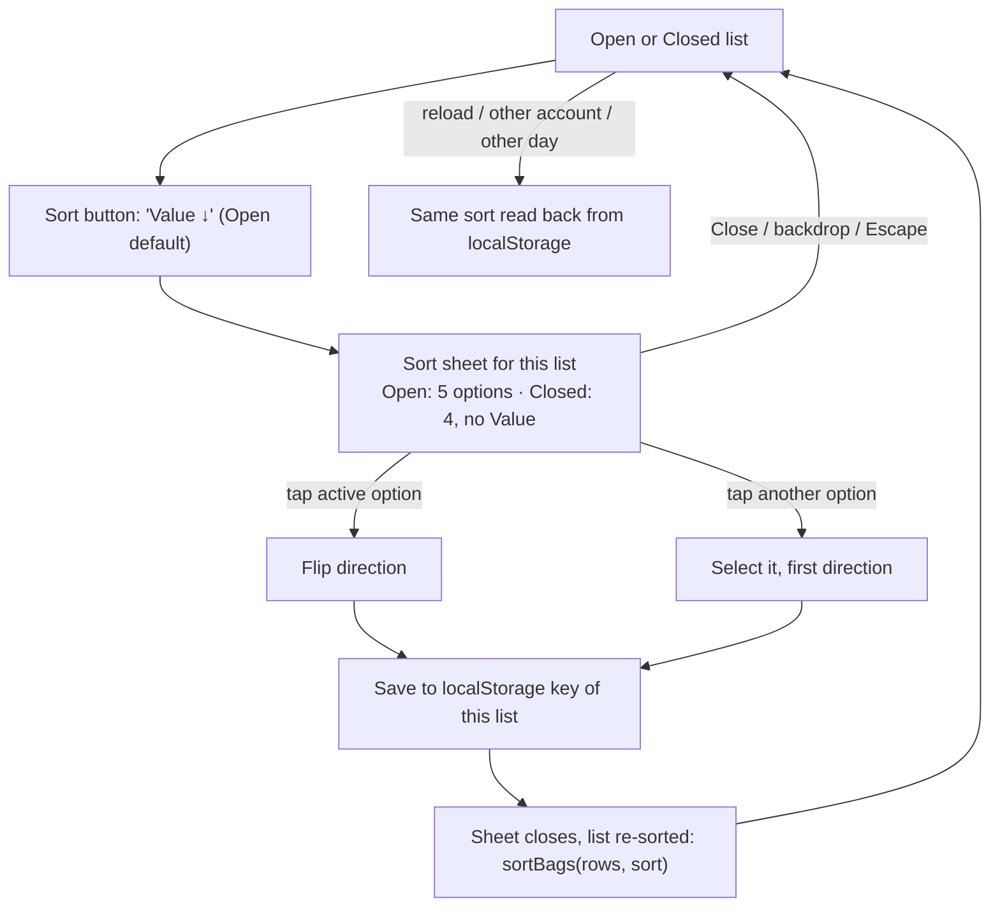
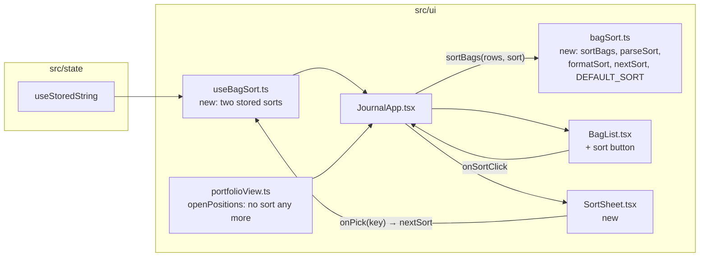

# List sorting — plan

> **Status:** In progress · **Owner:** @stanislavSav · **Decided:** 2026-10-12
> **Vocabulary:** [docs/CONTEXT.md](../CONTEXT.md) (Invested, Latest action, Device preference) · **Decisions:**
> [docs/README.md](../README.md) G4, G5 · **Depends on:** feature 2 ([docs/i18n/plan.md](../i18n/plan.md): `useT()`)
> · **Next:** feature 5 ([docs/storage-tags/plan.md](../storage-tags/plan.md)) filters before this sort ·
> **Tasks:** [tasks/](tasks/README.md) · **Parking lot:** [parking-lot/](parking-lot/README.md)

## 1. Why

The owner: "In open/closed section I want local sorting (saved on device, doesn't drop) by gain %, by amount invested,
by freshest action (buy or sell), or by asset name."

Today the order is fixed. Open bags are sorted by current value, then unpriced ones by cost
(`src/ui/portfolioView.ts:55-71`). Closed bags are sorted by the newest trade date (`src/domain/portfolio.ts:116`,
`:134-139`). To find the worst loser or the bag touched last week, the user scrolls and reads every row. After this
feature, each list has a **Sort** control (five choices on Open, four on Closed), and the choice stays on the device
after a reload. The Open default, **Value ↓**, keeps today's order.

## 2. Scope

**In:**

- A pure `sortBags(rows, sort)` in `src/ui/bagSort.ts`, plus parse / format / toggle helpers, with tests.
- A saved sort per list (Open, Closed) in `localStorage` (G5).
- A compact **Sort** button under the Open / Closed segmented control and a small sort sheet.
- English and Ukrainian text (G4).

**Out, deliberately:**

- Sorting the bag screen's trades (they are in calculation order on purpose, `src/domain/portfolio.ts:7-15`).
- A sort per account. One choice per list for all accounts (see defaults); revisit if the owner asks.
- Sorting by P/L in USD.
- A Value sort on the Closed tab (a closed bag holds no coins; see D10).
- Filtering. Feature 5 adds storage filter chips; they filter **before** `sortBags`.
- Changing `summarizeAccount`'s order. Other code depends on it (`openBagsFor`, `src/domain/actions.ts:165-171`, used
  by the bag choice in the Add trade sheet).

## 3. Decisions

| #   | Question                               | Decision                                                                                                                                                                                                                                                                                      |
| --- | -------------------------------------- | --------------------------------------------------------------------------------------------------------------------------------------------------------------------------------------------------------------------------------------------------------------------------------------------- |
| D1  | Which sort keys?                       | **Value** (Open only), **Gain %**, **Invested**, **Latest action**, **Name** (owner; Value added on 2026-10-12, [parking lot](parking-lot/01-open-default-order.md)).                                                                                                                         |
| D2  | What is "invested"?                    | Open bag: cost of the coins still held (`summary.cost`). Closed bag: total of all buys (`summary.invested`) (owner; matches CONTEXT.md).                                                                                                                                                       |
| D3  | What is "gain %"?                      | Open bag: `pos.unrealizedPct` (`src/domain/portfolio.ts:142-149`; null without a price). Closed bag: `realized / invested × 100`; unknown when `invested` is 0.                                                                                                                                 |
| D4  | What is "latest action"?               | The newest **known** trade date of the bag (`summary.lastDate`, `src/domain/portfolio.ts:87-99`). Trades with an unknown date are ignored; a bag with no dated trade has an unknown latest action. `createdAt` is **not** used (why: see below).                                               |
| D5  | Where do unknown values go?            | Always at the end, in both directions. Among themselves: name order (exception for Value: see D10).                                                                                                                                                                                          |
| D6  | What is "name" order?                  | Coin symbol A–Z, then bag name A–Z, with `Intl.Collator(undefined, { numeric: true, sensitivity: 'base' })`.                                                                                                                                                                                  |
| D7  | Ties                                   | Equal values are ordered by name (D6, always A–Z, also when the main order is reversed), then by `bag.id`. The result never depends on the input order.                                                                                                                                      |
| D8  | Where is the sort saved?               | `localStorage`, one key per list: `trade-journal:ui:sort:open`, `trade-journal:ui:sort:closed` (G5). Value `"<key>:<dir>"`, e.g. `"gain:desc"`. Not in backups. A missing or unknown value means the default.                                                                                   |
| D9  | Where is the sort function?            | `sortBags(rows, sort)` in `src/ui/bagSort.ts`, pure, no React. Feature 5 calls `sortBags(filterBags(rows, filter), sort)`.                                                                                                                                                                   |
| D10 | What is "value"?                       | Open bag: the current market value of the coins still held (`pos.value` = holding × live price, `src/domain/portfolio.ts:142-149`). Priced bags first; a bag without a price has an unknown value and goes to the end in both directions. Unpriced bags are ordered among themselves by cost (`summary.cost`, largest first), then by name, exactly as today (`src/ui/portfolioView.ts:65-70`). Closed bags have no value (nothing is held), so Value is **not offered on the Closed tab**. |
| D11 | Which options does each tab show?      | The option list is **per tab** (`SORT_KEYS`): Open = Value, Gain %, Invested, Latest action, Name; Closed = Gain %, Invested, Latest action, Name. A saved value with a key that the tab does not offer (for example `value:desc` under the Closed key) counts as unknown, so the tab shows its default. |
| D12 | Defaults                               | **Open = Value ↓** (owner, 2026-10-12): the same order as today's `openPositions` (only ties may differ: today by input order, now by name). **Closed = Latest action ↓**: today's Closed order (`byLastDateDesc`, unknown dates last).                                                          |

**Why D4 does not use `createdAt`:** `createdAt` is when the trade was typed into the app, not when it happened. A
2024 trade entered today without a date would jump to the top as the "freshest action". The date `null` means "I do not
know when", so it must not count as "now". Using only known dates also makes the Closed default (D12) give exactly
today's Closed order (`byLastDateDesc`, unknown dates last).

**Defaults decided without a question** (reversible; flag in review if wrong):

- One saved sort per list (Open, Closed), shared by all accounts.
- First direction when a key is chosen: Value ↓ (largest first), Gain % ↓ (highest first), Invested ↓ (largest first),
  Latest action ↓ (newest first), Name A–Z.
- Option order in the sheet: Value (Open only), Gain %, Invested, Latest action, Name.
- Tapping the **active** option flips its direction. Tapping another option selects it with its first direction. The
  sheet closes after every tap (one tap = one visible change).
- The control is a small text button under the segmented control, right-aligned, showing the current choice ("Gain %
  ↓", "Name A–Z"). It opens a sort sheet built on `Sheet` (`src/ui/Sheet.tsx`), not a new popover component. The
  sheet lists only the options of its tab (D11).
- `openPositions` (`src/ui/portfolioView.ts:55-71`) stops sorting; `sortBags` is the only place that orders list rows.
- Prices load after the list renders. With Value or Gain % on Open, unpriced rows sit at the end until prices arrive,
  then the list re-orders once (as today with the value order). The last-known prices are stored on the device, so usually the order is right on first paint.

## 4. User flow



Sort state per list:

```mermaid
stateDiagram-v2
  [*] --> Default: no saved value or unknown value
  Default --> Chosen: tap an option
  Chosen --> Chosen: tap active = flip; tap other = select (first direction)
  Chosen --> Chosen: reload (read from localStorage)
```

## 5. Screens

ASCII wireframes are the contract (no interactive mockup for this feature).

### 5.1 List with the sort button

```
┌──────────────────────────────┐
│ [   Open 5   |  Closed 3   ] │  segmented control (unchanged)
│ (feature 5 chips)     Value ↓│  sort button: small, muted text,
│ ┌──────────────────────────┐ │  right-aligned; min 44 px tap area;
│ │ BTC          $41,200     │ │  aria-label "Sort: Value,
│ │ Long-term    +12.4%      │ │  largest first"
│ │ 0.75 · avg $53,333       │ │
│ ├──────────────────────────┤ │
│ │ ETH          $14,100     │ │
│ │ …                        │ │
│ └──────────────────────────┘ │
└──────────────────────────────┘
```

The button is hidden when the list is empty (nothing to sort). The left side of the same row stays free for the
storage filter chips of feature 5.

### 5.2 Sort sheet

```
┌──────────────────────────────┐
│ Sort open bags         Close │
│ ┌──────────────────────────┐ │
│ │ Value        Largest ↓ ✓ │ │  role="radiogroup"; each row
│ │ Gain %                   │ │  role="radio" + aria-checked;
│ │ Invested                 │ │  active row shows its direction
│ │ Latest action            │ │
│ │ Name                     │ │
│ └──────────────────────────┘ │
│ Tap the chosen option again  │
│ to reverse the order.        │
│ Invested: cost of the coins  │  Open: cost of coins still held;
│ you still hold.              │  Closed: "total of all buys"
│ Bags without a price or date │
│ are always at the end.       │
└──────────────────────────────┘
```

The Closed sheet ("Sort closed bags") has four rows and no Value: Gain %, Invested, Latest action, Name. Its default
is Latest action, newest first.

### 5.3 Strings (EN + UK)

Use the key style that feature 2 set up in `src/i18n/en.ts` / `src/i18n/uk.ts`; the keys are suggestions. The Ukrainian
word for *bag* is «позиція» (owner decision 2026-10-12, feature 2 plan D18), and the texts use the polite Ви form (D17).

| Key (suggested)             | English                                                  | Ukrainian (draft, owner to check)                            |
| --------------------------- | -------------------------------------------------------- | ------------------------------------------------------------ |
| `sort.button`               | {key} {dir}                                              | {key} {dir}                                                  |
| `sort.buttonLabel`          | Sort: {key}, {dirLong}                                   | Сортування: {key}, {dirLong}                                 |
| `sort.title.open`           | Sort open bags                                           | Сортувати відкриті позиції                                   |
| `sort.title.closed`         | Sort closed bags                                         | Сортувати закриті позиції                                    |
| `sort.key.value`            | Value                                                    | Вартість                                                     |
| `sort.key.gain`             | Gain %                                                   | Дохідність %                                                 |
| `sort.key.invested`         | Invested                                                 | Вкладено                                                     |
| `sort.key.latest`           | Latest action                                            | Остання дія                                                  |
| `sort.key.name`             | Name                                                     | Назва                                                        |
| `sort.dir.desc` (short)     | ↓                                                        | ↓                                                            |
| `sort.dir.asc` (short)      | ↑                                                        | ↑                                                            |
| `sort.dir.nameAsc`          | A–Z                                                      | A–Z                                                          |
| `sort.dir.nameDesc`         | Z–A                                                      | Z–A                                                          |
| `sort.dirLong.largest`      | largest first                                            | спочатку найбільші                                           |
| `sort.dirLong.smallest`     | smallest first                                           | спочатку найменші                                            |
| `sort.dirLong.newest`       | newest first                                             | спочатку найновіші                                           |
| `sort.dirLong.oldest`       | oldest first                                             | спочатку найстаріші                                          |
| `sort.hint.flip`            | Tap the chosen option again to reverse the order.        | Торкніться вибраного ще раз, щоб змінити порядок.            |
| `sort.hint.investedOpen`    | Invested: cost of the coins you still hold.              | Вкладено: собівартість монет, які ще у вас.                  |
| `sort.hint.investedClosed`  | Invested: total of all buys.                             | Вкладено: сума всіх купівель.                                |
| `sort.hint.unknown`         | Bags without a price or date are always at the end.      | Позиції без ціни чи дати завжди в кінці.                     |

Symbols and bag names are not translated; the name order uses the device's collation.

## 6. Architecture



### 6.1 Seams

```ts
// src/ui/bagSort.ts
export type SortKey = 'value' | 'gain' | 'invested' | 'latest' | 'name'
export type SortDir = 'asc' | 'desc'
export interface BagSort { key: SortKey; dir: SortDir }

/** The options each tab offers, in sheet order (D11). */
export const SORT_KEYS: Record<ListTab, readonly SortKey[]> // open: value, gain, invested, latest, name; closed: gain, invested, latest, name

/** Open rows are OpenPosition (has pos); closed rows are { summary }. Open vs closed comes from summary.status. */
export interface SortableRow { summary: BagSummary; pos?: PositionValue }

export const DEFAULT_SORT: Record<ListTab, BagSort> // open: value desc, closed: latest desc
export const FIRST_DIR: Record<SortKey, SortDir>    // value/gain/invested/latest: desc, name: asc

/** New array; does not mutate rows. Unknown values last in both directions; ties by name A–Z, then bag.id. */
export function sortBags<T extends SortableRow>(rows: readonly T[], sort: BagSort): T[]
export function parseSort(raw: string | null, tab: ListTab): BagSort // bad, missing, or key not in SORT_KEYS[tab] → DEFAULT_SORT[tab]
export function formatSort(sort: BagSort): string                    // "gain:desc"
export function nextSort(current: BagSort, key: SortKey): BagSort    // same key → flip; other key → FIRST_DIR[key]
```

Value of each key (`null` = unknown):

| Key      | Open row (`summary.status === 'open'`) | Closed row                                       |
| -------- | -------------------------------------- | ------------------------------------------------ |
| value    | `pos?.value ?? null`; unknown rows among themselves: `summary.cost` ↓, then name | not offered (D11); `null` if called |
| gain     | `pos?.unrealizedPct ?? null`           | `invested > 0 ? realized / invested * 100 : null` |
| invested | `summary.cost`                         | `summary.invested`                               |
| latest   | `summary.lastDate` (ISO string)        | `summary.lastDate`                               |
| name     | `symbol`, then `bag.name` (never null) | same                                             |

```ts
// src/ui/useBagSort.ts
export function useBagSort(): { sorts: Record<ListTab, BagSort>; pick: (tab: ListTab, key: SortKey) => void }
// wraps useStoredString('trade-journal:ui:sort:open') and useStoredString('trade-journal:ui:sort:closed')
```

- `JournalApp` (`src/ui/JournalApp.tsx:53-57`): `positions` stay unsorted for `openTotals`;
  `openRows = sortBags(positions, sorts.open)`, `closedRows = sortBags(summary.closed.map((s) => ({ summary: s })),
  sorts.closed)`, both in `useMemo`. `SheetState` (`:32-37`) gets `{ kind: 'sort'; tab: ListTab }`.
- `BagList` (`src/ui/BagList.tsx`): takes the sorted rows, the current `BagSort` of the shown tab, and
  `onSortClick()`. `ClosedRow` still gets `row.summary`.
- `openPositions` (`src/ui/portfolioView.ts:55-71`): remove the `.sort(...)` and update its doc comment.
- Feature 5 composes: `sortBags(filterBags(rows, filter), sort)`. `sortBags` does not care how many rows it gets.

## 7. Libraries

| Need             | Choice                      | Licence | Why                                                     |
| ---------------- | --------------------------- | ------- | ------------------------------------------------------- |
| Name collation   | `Intl.Collator` (built in)  | —       | Handles Cyrillic bag names and "Jun 3" < "Jun 26".      |
| Everything else  | none                        | —       | Pure TypeScript; `Sheet` and `useStoredString` exist.   |

## 8. Constraints that shape the design

- `BagSummary` already has every value needed: `cost`, `invested`, `realized`, `lastDate`
  (`src/domain/types.ts:62-75`); open rows have `pos.value` and `pos.unrealizedPct` (`src/ui/portfolioView.ts:12-16`).
  No domain change.
- Today's two orders live in two places: `summarizeAccount` (`src/domain/portfolio.ts:115-116`) and `openPositions`
  (`src/ui/portfolioView.ts:65-70`). Only the second one is replaced; the domain order stays for `openBagsFor`.
- `useStoredString` reads once on mount and guards every access (private mode) (`src/state/useStoredString.ts:4-26`).
  It does not follow other tabs; that is fine for a preference.
- The device-preference key prefix is `trade-journal:ui:` (G5); the selected account already uses
  `trade-journal:ui:account` (`src/ui/JournalApp.tsx:44`).
- Tests run in `environment: 'node'` (`vite.config.ts`), so the testable logic must be in plain functions
  (`bagSort.ts`), not in components.
- Closed bags can have `invested === 0` (only sells, `src/domain/portfolio.ts:82`): gain is unknown then.
- Open rows have no date on screen (`src/ui/BagRows.tsx:18-42`); see
  [parking lot](parking-lot/02-show-sort-value-in-row.md).

## 9. Risks

| Risk                                                            | Likelihood | Impact | Mitigation                                                                                  |
| --------------------------------------------------------------- | ---------- | ------ | ------------------------------------------------------------------------------------------- |
| The Open default changes the order the owner is used to         | Low        | Low    | Default Value ↓ is today's order; only ties may differ (D12).                               |
| List jumps when prices arrive (Value, Gain %)                   | Medium     | Low    | Last-known prices are stored; at most one re-order (the same as today).                     |
| A Value sort is saved for the Closed list (old or edited value) | Low        | Low    | `parseSort` checks `SORT_KEYS[tab]` and falls back to the Closed default; tested.           |
| "Latest action" on Open looks random because no date is shown   | Medium     | Low    | Hint text; [parking lot](parking-lot/02-show-sort-value-in-row.md).                         |
| An old or garbage value in localStorage breaks the list         | Low        | Medium | `parseSort` falls back to the default; tested.                                              |
| Ukrainian words differ from feature 2's glossary                | Medium     | Low    | Task 02 takes the words from `src/i18n/uk.ts`.                                              |

## 10. Rollout

No flag. Ship when tasks 01–02 are `Done`: `npm test`, `npm run typecheck`, `npm run build` pass; push to `main`;
Pages redeploys. Manual check on the iPhone (task 02). Rollback: revert the commit; the saved keys are then unused and
harmless.

## 11. Open, deliberately

- Showing the sort value in the row ([parking lot](parking-lot/02-show-sort-value-in-row.md)).
- Sort per account, if the owner asks.

Questions that come up while building go to [parking-lot/](parking-lot/README.md), one file each (template:
`docs/_templates/parking-lot.md`).
