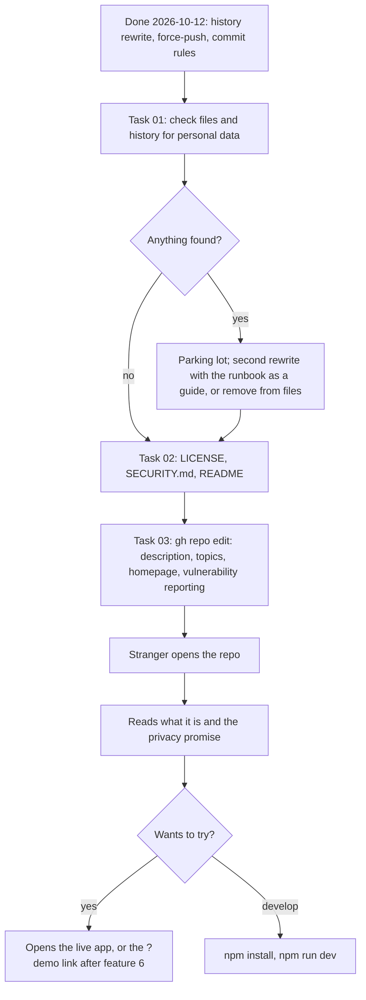
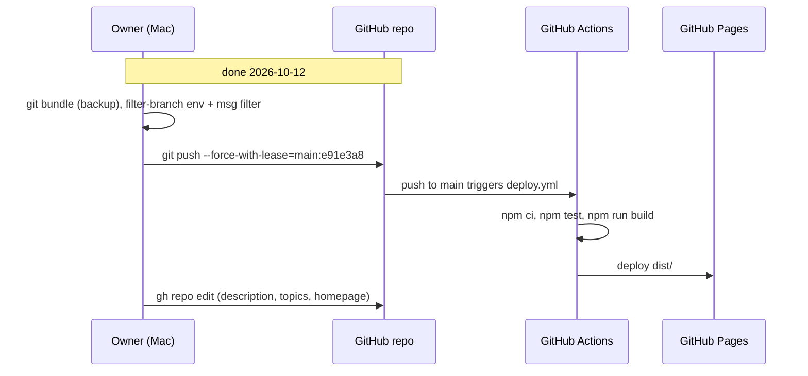

# Open source — plan

> **Status:** Shipped — the history rewrite is done (2026-10-12, [runbook](history-rewrite-runbook.md) run log);
> tasks 01–03 are done (2026-10-12). **Owner:** @stanislavSav · **Decided:** 2026-10-12
> **Vocabulary:** [docs/CONTEXT.md](../CONTEXT.md) · **Decisions:** [docs/README.md](../README.md) G1, G2, G3, G7 ·
> **Runbook:** [history-rewrite-runbook.md](history-rewrite-runbook.md) · **Tasks:** [tasks/](tasks/README.md)
> · **Parking lot:** [parking-lot/](parking-lot/README.md)

## 1. Why

The repository is already public at `github.com/stanislavSav/trade-journal`, and the app is live at
`https://stanislavsav.github.io/trade-journal/`. But a stranger who finds it cannot tell what it is, whether they may
use it, or whether it is safe to put their trades in it. There is no licence and the README is written for the owner.
Until 2026-10-12 the two commits also showed the owner's work email; that is already fixed (history rewrite, see D3).
The owner also could not find the repo at first, because it is under the personal account `stanislavSav`, not the
owner's work GitHub account.

After this feature, the repo has an MIT licence, a README for strangers (what it is, privacy, how to install, how to
try it, how to develop), a `SECURITY.md`, and a correct GitHub description. No commit shows the work email.

## 2. Scope

**In:**

- A check that no personal data or secrets are in tracked files or in git history.
- A history rewrite of all commits to the GitHub noreply address of `stanislavSav`, and a repo-local git identity for
  future commits. **Done 2026-10-12** ([runbook](history-rewrite-runbook.md), kept as a record).
- `LICENSE` (MIT, copyright Stanislav Savchuk) and `"license": "MIT"` in `package.json`.
- `README.md` rewritten for strangers.
- `SECURITY.md`: how to report a problem, and a short threat model.
- GitHub repo settings with `gh`: description, topics, homepage, private vulnerability reporting.

**Out, deliberately:**

- Moving the repo to another account or organisation (G1: it stays where it is).
- `CONTRIBUTING.md`, issue templates, code of conduct, CI badges. This is a personal tool; a stranger can open an
  issue without templates. Add them when someone really contributes. The commit rules already exist in `CLAUDE.md`
  at the repo root (commit `d540f39`); the README links to them instead of repeating them.
- Real screenshots of the owner's data. Screenshots must show sample data only (see
  [parking lot item](parking-lot/02-screenshots-source.md)).
- The `?demo` link on the live app. That is feature 6 ([docs/demo-data/plan.md](../demo-data/plan.md)); this feature
  only leaves a place for it in the README.
- Translating the README to Ukrainian. The app gets Ukrainian in feature 2; the README stays English.

## 3. Decisions

| #   | Question                                   | Decision                                                                                                                                                                                                  |
| --- | ------------------------------------------ | --------------------------------------------------------------------------------------------------------------------------------------------------------------------------------------------------------- |
| D1  | Where does the repo live?                  | Stays at `github.com/stanislavSav/trade-journal` (G1).                                                                                                                                                    |
| D2  | Licence                                    | MIT, `Copyright (c) 2026 Stanislav Savchuk` (G2).                                                                                                                                                         |
| D3  | What to do with the work email in history  | Rewrite every commit (author and committer) to `Stanislav Savchuk <103412957+stanislavSav@users.noreply.github.com>` and remove co-author trailer lines from the messages. Force-push to `main` (G3). **Done 2026-10-12**: old tip `e91e3a8` → `f961d0f`, `b24f49c`. |
| D4  | Future commits                             | Repo-local `git config user.name` / `user.email` in this repo only (set 2026-10-12). The global git config stays the work identity, because other repos on this Mac need it. Commit rules: `CLAUDE.md`; the `.githooks/commit-msg` hook rejects co-author trailers (enable per clone: `git config core.hooksPath .githooks`). |
| D5  | Rewrite tool                               | `git filter-branch --env-filter --msg-filter` (built into git; `git-filter-repo` is not installed). Bundle backup of all refs first; push with `--force-with-lease=main:e91e3a8`. Used on 2026-10-12. |
| D6  | How strangers report a security problem    | GitHub private vulnerability reporting (Security tab → "Report a vulnerability"). No email address is published.                                                                                          |
| D7  | What the README promises about privacy     | Only what the code does today: no server, no account, no analytics; data in the browser's `localStorage`; the only network calls go to `api.coingecko.com` (prices and coin search) (G7).                  |

**Defaults decided without a question** (reversible; flag in review if wrong):

- Topics: `pwa`, `crypto`, `trade-journal`, `portfolio-tracker`, `react`, `typescript`, `vite`, `offline-first`,
  `localstorage`, `coingecko`.
- Description: "Private crypto trade journal PWA. Average cost per bag, live CoinGecko prices. Data stays in your
  browser."
- `SECURITY.md` supports only the latest version on `main` (the live app updates itself).
- The README keeps the existing "How data works" section (it is already correct) and adds sections around it.

## 4. User flow

The "user" here is the owner doing the work, then a stranger reading the repo.



## 5. Screens

No app screens change. The "screen" is the GitHub repo page. The README is the contract:

```
┌───────────────────────────────────────────────────────┐
│ stanislavSav / trade-journal                 Public   │
│ About: Private crypto trade journal PWA. …            │
│ 🔗 stanislavsav.github.io/trade-journal/              │
│ pwa crypto trade-journal portfolio-tracker …          │
│ MIT license · Security policy                         │
├───────────────────────────────────────────────────────┤
│ # Trade Journal                                       │
│ One-paragraph what it is + live link                  │
│ [screenshot placeholder: list · bag · add trade]      │
│ ## Features          (bags, average cost, backups …)  │
│ ## Privacy           (no server, no tracking,         │
│                       only CoinGecko, your backup     │
│                       file is plain JSON)             │
│ ## Install on iPhone (Safari → Share → Add to Home)   │
│ ## Try it            (live app; ?demo after feat. 6)  │
│ ## How data works    (kept from today's README)       │
│ ## Develop           (npm scripts, deploy, link to    │
│                       commit rules in CLAUDE.md)      │
│ ## Licence           (MIT)                            │
└───────────────────────────────────────────────────────┘
```

## 6. Architecture

No app code changes. Files touched in tasks:

| File                                  | Change                                                                                      |
| ------------------------------------- | ------------------------------------------------------------------------------------------- |
| `LICENSE`                             | new, MIT text                                                                               |
| `SECURITY.md`                         | new                                                                                         |
| `README.md`                           | rewritten; "How data works" kept                                                            |
| `package.json`                        | add `"license": "MIT"`. Keep `"private": true` (it only stops `npm publish`).               |
| `.git/config` (local, not committed)  | `user.name`, `user.email`, `core.hooksPath` — **done 2026-10-12**                            |
| git history                           | author/committer rewritten — **done 2026-10-12** (runbook)                                  |
| `CLAUDE.md`, `.githooks/commit-msg`, `.claude/settings.json` | commit rules — **done 2026-10-12** (`d540f39`); README links to `CLAUDE.md` |
| GitHub repo settings                  | description, topics, homepage, private vulnerability reporting                              |

Facts the README must use (do not invent others):

- Prices and coin search call `https://api.coingecko.com/api/v3` (`src/prices/index.ts:17`, `:55`, `:121`). The
  service worker never caches these calls (`vite.config.ts`, `runtimeCaching` → `NetworkOnly`).
- The journal lives in `localStorage` under `trade-journal:journal:v1` (`src/storage/index.ts:9`).
- The backup is `trades.json`, plain JSON, not encrypted; `trades*.json` is in `.gitignore`.
- The app is served from `/trade-journal/` (`vite.config.ts`, `base`) and deployed by `.github/workflows/deploy.yml`
  on every push to `main` (tests, build, upload `dist/` to Pages).
- Dev preview data already exists: `?demo` works in `npm run dev` only (`src/state/demo.ts:4-5`, `import.meta.env.DEV`).



## 7. Libraries

| Need                  | Choice            | Licence | Why                                                                                      |
| --------------------- | ----------------- | ------- | ---------------------------------------------------------------------------------------- |
| Rewrite git history   | `git filter-branch` (built into git) | GPL-2.0 (part of git) | Already installed; fine for 2 commits. For a bigger rewrite next time, prefer `git-filter-repo` (MIT). Dev tool only. |
| Secret scan (optional)| `gitleaks`        | MIT     | Scans every commit for keys and tokens. Optional in task 01; a `git log -p | grep` covers this tiny history too. |

## 8. Constraints that shape the design

- History after the rewrite (2026-10-12): 3 commits on `main` (`f961d0f`, `b24f49c`, `d540f39`), no tags, no other
  branches, all with `Stanislav Savchuk <103412957+stanislavSav@users.noreply.github.com>` as author and committer.
- These docs must not contain the work email or the employer's name: they are public. Commands that need the old
  email read it from a variable instead of spelling it out.
- The `docs/` folder was still untracked during the rewrite; it is committed later with the new identity, so it needs
  no rewrite — but check it for the work email before that commit (task 01 step 5).
- The rewrite changed every commit hash. Any other clone must re-clone or reset.
- GitHub can keep the old commits reachable by their hash for some time after a force-push (cached views), and the
  contributors graph can take time to refresh. A full purge needs GitHub Support. See
  [parking lot](parking-lot/01-old-commits-on-github.md).
- Every commit message is checked by `.githooks/commit-msg` (no co-author trailers, no tool mentions), once
  `core.hooksPath` is set in the clone. Commit messages proposed in these docs follow that rule.
- A push to `main` redeploys the live app (`.github/workflows/deploy.yml`, `on.push.branches: [main]`). The build is
  the same code, so users see no change; the service worker may update once.
- `gh` on this Mac may be logged in as the work account. `gh repo edit` on `stanislavSav/trade-journal` needs the
  `stanislavSav` account (`gh auth status`, `gh auth switch`).
- First look at tracked files (2026-10-12): `git grep -i` for the work email domain, the surname, `password|secret|token|api_key`
  found only false positives (`id-token: write` in the workflow, `js-tokens` in `package-lock.json`, a `token`
  variable in `src/ui/Sheet.tsx`). Task 01 repeats this over the whole history.

## 9. Risks

| Risk                                                            | Likelihood | Impact | Mitigation                                                                                                   |
| --------------------------------------------------------------- | ---------- | ------ | ------------------------------------------------------------------------------------------------------------ |
| Old commits still visible on GitHub by hash; contributors graph still shows the work account for a while | Medium | Low | Check the old commit URL; ask GitHub Support to purge if needed ([parking lot](parking-lot/01-old-commits-on-github.md)). |
| Bundle backup (holds the work email) is lost or leaks            | Low        | Low    | It sits in a temporary scratchpad; keep a copy only if a rollback may be needed, then delete it (runbook §5). |
| README promises more privacy than the code gives                | Low        | High   | D7: only the facts listed in §6; mention that CoinGecko sees the IP and the coin ids.                        |
| Next commit uses the work email again (e.g. in another clone)   | Low        | Medium | Repo-local `user.email` (D4); `CLAUDE.md` rules; task 02 checks `git log -1 --format=%ae` after its commit.    |
| App icons may not be the owner's to license                     | Low        | Medium | [parking lot](parking-lot/02-icons-licence.md).                                                              |

## 10. Rollout

0. **Done 2026-10-12:** history rewrite + force-push + commit rules commit; Pages deploy green
   ([runbook run log](history-rewrite-runbook.md#run-log)).
1. Task 01: audit files and history. If something is found, park it and fix it before task 02.
2. Task 02: commit `LICENSE`, `SECURITY.md`, `README.md`, `package.json` with the new local identity. Push. Pages
   redeploys (no app change).
3. Task 03: `gh repo edit`; enable private vulnerability reporting.

Rollback: the history rewrite rolls back from the bundle while it exists (runbook §4). Docs commits roll back with `git revert`. Repo
settings roll back with `gh repo edit`.

## 11. Open, deliberately

- Screenshots in the README wait for sample data ([parking lot](parking-lot/02-screenshots-source.md)).
- The "Try it" section links to `?demo` only after feature 6 ships; feature 6's tasks must update the README.
- `CONTRIBUTING.md` and issue templates: add when there is a real contributor.

Questions that come up while building go to [parking-lot/](parking-lot/README.md), one file each (template:
`docs/_templates/parking-lot.md`).
