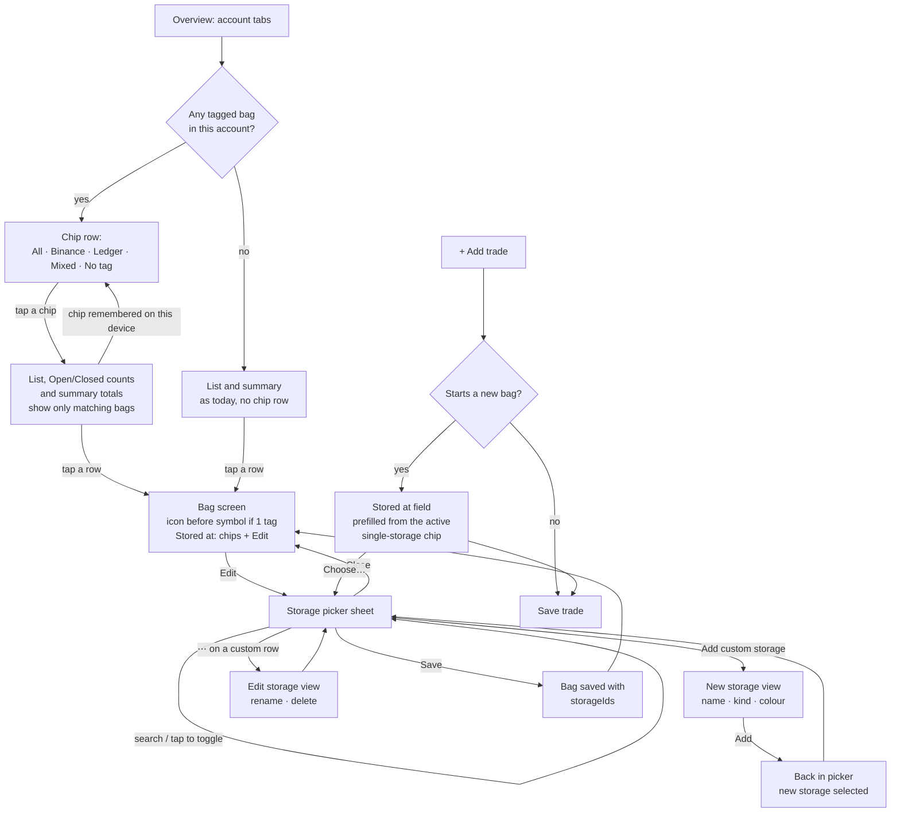
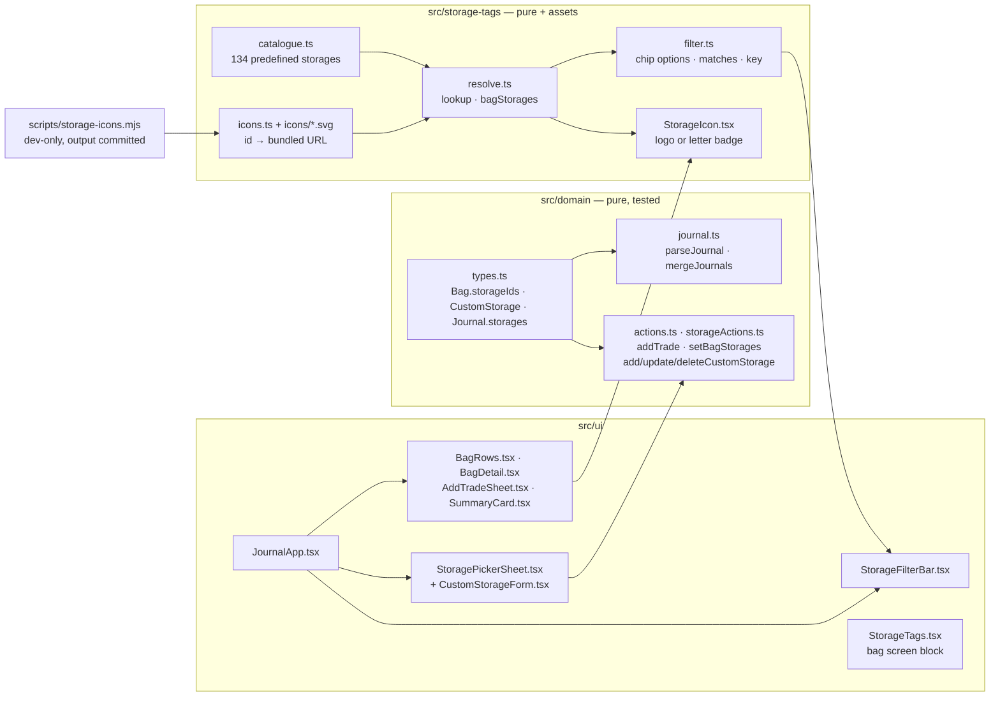
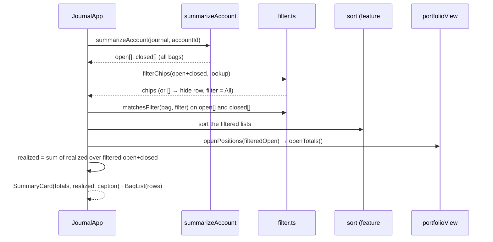
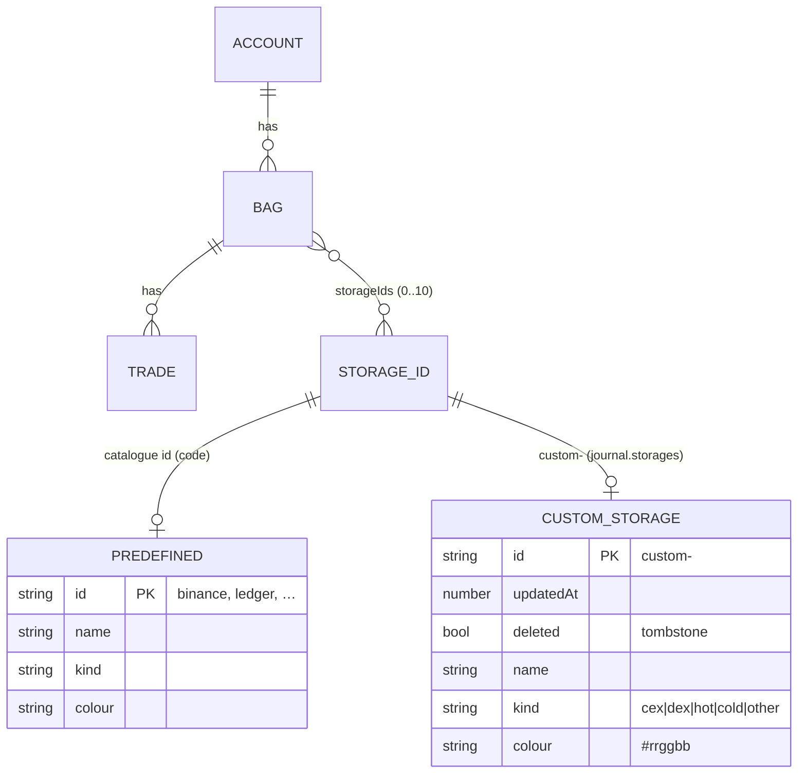

# Storage tags — plan

> **Status:** In progress · **Owner:** @stanislavSav · **Decided:** 2026-10-12
> **Vocabulary:** [docs/CONTEXT.md](../CONTEXT.md) (Bag, Storage, Storage tag, Tombstone, Device preference) ·
> **Decisions:** §3 below and the global decisions G1–G7 in [docs/README.md](../README.md) · **Mockup:** none, the
> wireframes in §5 are the contract · **Catalogue:** [catalogue.md](catalogue.md) · **Tasks:** [tasks/](tasks/README.md)
> · **Parking lot:** [parking-lot/](parking-lot/README.md)

## 1. Why

People keep their coins in many places: an exchange account, a phone wallet, a hardware wallet in a drawer. Today the
journal knows *what* was bought and *at what cost*, but not *where* the coins are. The owner wants to see this at a
glance and to ask "what do I hold on Binance, and how is it doing?".

When this ships, each bag can carry one or more **storage tags** (Binance, Ledger, a custom "Safe deposit box", …). A bag
with exactly one tag shows the storage logo before the coin symbol. A row of **filter chips** above the list shows only
the bags of one storage, and the summary card totals follow that filter. A catalogue of 134 predefined storages
(97 with a bundled logo) makes tagging fast. The user can add their own storages too.

## 2. Scope

**In:**

- An optional list of storage ids on each bag (`Bag.storageIds`).
- A predefined **catalogue** of exchanges (CEX), DEXes, hot wallets and cold wallets, with brand colours and bundled
  logos ([catalogue.md](catalogue.md)).
- **Custom storages** (name, kind, colour) as a new synced journal collection, so they travel in backups. Rename and
  delete (tombstone).
- A **storage picker** sheet: search, groups by kind, multi-select, "Add custom storage".
- Tags on the **bag screen** (chips + Edit) and an optional **Stored at** field when a trade starts a new bag.
- The storage **icon before the coin symbol** in list rows and in the bag screen header, when a bag has exactly one tag.
- **Filter chips** on the overview: All · each single storage · Mixed · No tag. The summary card follows the filter. The
  chosen chip is a device preference.
- A build-time script that copies logos from two open icon sets and from official brand kits into the app, with a
  licence notice. A **letter badge** when no logo is available.
- English and Ukrainian UI text for everything new (G4).

**Out, deliberately:**

- **Quantities per storage.** A tag says "this bag is kept here". It does not split a bag's coins between two places.
  A bag with two tags is "Mixed"; the user who wants exact numbers per place makes two bags. Splitting would change the
  average-cost model and every number in the app.
- **Transfers between storages** (moving coins from Binance to Ledger as an event with a date). Changing the tag is
  enough for a personal journal. Parked in §11.
- **Links to the storage websites** and any network call for logos (G7). Logos are bundled; nothing is fetched.
- **Tags on accounts or trades.** Tags live on bags only (D1).
- **Filtering by kind** (all hot wallets, all exchanges). Parked in §11.
- **Demo data with tags.** The demo-data feature (roadmap #6) adds tags to its sample bags.
- **Custom logos** uploaded by the user (images in `localStorage` would bloat backups). Custom storages get a letter
  badge in a chosen colour.

## 3. Decisions

| #   | Question                                     | Decision                                                                                                                                                                                                                                                                                                                                                                     |
| --- | -------------------------------------------- | ---------------------------------------------------------------------------------------------------------------------------------------------------------------------------------------------------------------------------------------------------------------------------------------------------------------------------------------------------------------------------- |
| D1  | What carries the tag?                        | Each **bag**. Every list row is a bag, and two BTC bags can be kept in different places. A bag can have several tags.                                                                                                                                                                                                                                                       |
| D2  | How does the overview filter?                | A horizontally scrolling row of **filter chips**: **All** · each storage that is the *only* tag of at least one bag in this account · **Mixed** (bags with 2 or more tags) · **No tag**. A tap shows only those bags. The **summary card totals follow the filter**. The row is hidden when no bag of the account has a tag.                                                 |
| D3  | Is the chosen filter remembered?             | Yes, as a **device preference** (G5): `localStorage` key `trade-journal:ui:storage-filter`, not in backups. When the remembered chip does not exist in the current account, the app shows **All** (and keeps the stored value, so it comes back on the account that has it).                                                                                                  |
| D4  | Which icons?                                 | **Real logos, bundled in the app.** They work offline and nothing is fetched from a third party (G7). A logo is used only to name the service; the app does not suggest any partnership.                                                                                                                                                                                    |
| D5  | Where does the icon show?                    | With **exactly one** tag, the storage icon shows **before the coin symbol** in the list row and in the bag screen header. With 0 or 2+ tags there is no icon before the symbol.                                                                                                                                                                                             |
| D6  | How does the filter work with sorting (#4)?  | **Filter first, then sort.** The sort from feature #4 runs on the filtered list.                                                                                                                                                                                                                                                                                              |
| D7  | Languages                                    | All new UI text is in English and Ukrainian through the typed dictionary from feature #2 (`src/i18n/en.ts`, `src/i18n/uk.ts`, `useT()`). **Storage brand names are not translated.** Kind labels (Exchange, DEX, Hot wallet, Cold wallet, Other) and group labels (Custom, Used in this journal) are translated. Custom storage names are user text and stay as typed. |
| D8  | Which brands get a real logo?                | **Every brand that has a logo source** (Simple Icons, Web3 Icons, the official brand kit or the project repository), **including the 13 brands whose terms ask for permission first** (Ledger, Trezor, MEXC, Bitfinex, Gemini, PayPal, Cash App, Bitvavo, LBank, Paradex, Aster, Orca, Satochip). Owner decision 2026-10-12 ([parking lot 02-restricted-logos](parking-lot/02-restricted-logos.md)). A letter badge is drawn only where no logo source exists and for custom storages. The licence notice and the trademark sentence stay (§6.4). If a brand asks to remove its logo, it gets a letter badge (§9). |
| D9  | Are closed storages listed?                  | **No.** Kuna, EXMO, FTX and Zonda are not in the catalogue; the user adds them as **custom storages**. Owner decision 2026-10-12 ([parking lot 02-closed-storages](parking-lot/02-closed-storages.md)). Catalogue ids are never removed, so a listed storage that closes later stays in the catalogue (bags use its id).                                                   |

**Defaults decided without a question** (reversible; flag in review if wrong):

- **Data model.** `Bag` gets `storageIds?: string[]`. Predefined storages live in code, in a catalogue module with
  stable lower-case ids (`binance`, `ledger`, `paper-backup`). Custom storages are a new synced collection
  `Journal.storages` (`Synced` + `name` + `kind` + `colour`), so they travel in backups. Custom ids are
  `custom-<uuid>`, so they can never clash with a catalogue id.
- **Backup format.** `version` stays `1`. `storageIds` and `storages` are optional when a backup is parsed, so every
  old backup still loads. An old app version ignores the new data (risk analysed in §9).
- **"No tags" is written as an empty list.** When the user removes the last tag, the bag is saved with
  `storageIds: []`, not without the field. A bag *without* the field means "never tagged, or saved by an old app
  version". This lets the merge keep tags that an old app version dropped (§6.3, §9).
- **Unknown ids are kept and ignored.** A tag whose id is not in the catalogue and not a live custom storage (a deleted
  custom storage, or a catalogue id from a newer app version) stays in `storageIds` but is not shown and does not
  count. A bag with `[binance, <deleted custom>]` counts as "only Binance".
- **Kinds.** `cex` · `dex` · `hot` · `cold` · `other`. Predefined storages use the first four. `other` is for custom
  storages that fit none (a bank safe, a friend). Labels: Exchange · DEX · Hot wallet · Cold wallet · Other.
- **Editing tags.** On the bag screen: tag chips plus an **Edit** button that opens the picker. In *Add trade*, an
  optional **Stored at** field appears only when the trade starts a **new** bag.
- **Picker.** A search box, then the group **Used in this journal** (storages already on any bag, all accounts), then
  **Exchanges**, **DEX**, **Hot wallets**, **Cold wallets**, **Custom**. Inside a group the order is alphabetical.
  Multi-select. Changes apply on **Save**; Close discards them. Search matches the name, the id and known old names
  (`huobi` finds HTX, `bitkeep` finds Bitget Wallet).
- **Custom storage form** is a second view inside the picker sheet (‹ Back), not a third stacked sheet. Fields: name
  (1–30 characters, must not equal an existing name, case-insensitive), kind, colour (8 fixed colours). The icon is a
  letter badge: the first letter of the name, white on the chosen colour.
- **Rename / delete a custom storage** from its row in the picker (⋯). Delete needs a second tap ("Tap again to
  delete", as in `EditTradeSheet`) and says how many bags use it. Delete writes a tombstone; bags keep the id (see
  "Unknown ids").
- **Chip order:** All, then the single storages by name, then Mixed, then No tag. Mixed and No tag show only when at
  least one bag is in that group. Chips have no counts; the Open / Closed counts already follow the filter.
- **Chip row position:** under the account tabs, above the summary card, because the filter changes the card *and* the
  list.
- **Summary caption:** when the filter is not All, the summary card shows a small caption under Value: "Only Binance",
  "Only mixed storage", "Only bags without a tag".
- **One filter for all accounts** (one key), with the fallback in D3.
- **Prefill.** When a single-storage chip is active and the user adds a trade that starts a new bag, **Stored at** is
  prefilled with that storage. Otherwise the new bag would disappear from the filtered list right after saving.
- **Prices** are still fetched for *all* open bags of the account, not only the filtered ones, so switching chips never
  starts a network call.
- **Logo sources, in this order:** Simple Icons (CC0), Web3 Icons (MIT), the official brand kit SVG, the logo file of
  the project's open-source repository, else a letter badge in the brand colour. Details in §6.4 and
  [catalogue.md](catalogue.md).
- **Generic entries** "Paper / steel backup" and "Other hardware wallet" use two small icons drawn for this app.
- **Icon look:** every logo is a square tile (brand-colour background, logo glyph on top) shown with rounded corners.
  The tile carries its own background, so it reads the same in light and dark mode.
- **Maximum 10 tags per bag** (domain check). Nobody keeps one bag in more places; the limit stops a bad backup from
  carrying huge lists.

## 4. User flow



## 5. Screens

The ASCII wireframes are the contract. There is no interactive mockup for this feature. Sizes: icon 18 px in list rows,
28 px in the bag screen header, 28 px in picker rows, 16 px in chips.

### 5.1 Overview: chip row and icon before the symbol

```
┌──────────────────────────────────┐
│ (CS) (Family)  +            ⤓ ●  │  existing header: account tabs, backup
│ ┌─────┐┌──────────┐┌─────────┐┌──│  chip row, scrolls sideways
│ │ All ││◆ Binance ││▣ Ledger ││Mi│  selected chip = filled
│ └─────┘└──────────┘└─────────┘└──│  hidden when no bag has a tag
├──────────────────────────────────┤
│ ┌──────────────────────────────┐ │
│ │ Value             $30,100.00 │ │  totals of the filtered bags
│ │ Only Binance                 │ │  caption, only when not "All"
│ │ Open P/L     +$3,300  +12.4% │ │
│ │ Realized          +$1,000.00 │ │  realized of filtered bags
│ │ prices 12:04 · ⟳             │ │
│ └──────────────────────────────┘ │
│ [    Open 2    |   Closed 1    ] │  counts follow the filter
│ ┌──────────────────────────────┐ │
│ │ ◆ BTC               $28,000  │ │  ◆ = Binance logo, 18 px,
│ │ Long-term            +12.0%  │ │  before the symbol (1 tag)
│ │ 0.5 · avg $50,000            │ │
│ │ ◆ SOL                $2,100  │ │
│ │ Jul 26               +5.0%   │ │
│ └──────────────────────────────┘ │
│                            ( + ) │
└──────────────────────────────────┘

With the chip "All": a bag with 2+ tags or no tag shows no icon:
│ │ ETH                 $12,000  │ │  Mixed (Binance + Ledger)
│ │ DOGE                   $900  │ │  No tag
```

### 5.2 Bag screen: tags

```
┌──────────────────────────────────┐
│ ‹ CS                             │
│ ◆ BTC  [Open]                    │  28 px icon when exactly 1 tag
│ Long-term                Rename  │  existing BagName
│ Bitcoin                          │
│ Stored at                  Edit  │  Edit opens the picker (5.3)
│ (◆ Binance)                      │  one chip per tag, not tappable
├──────────────────────────────────┤
│ ┌ Holding · Avg cost · … ┐       │  existing stats card
│ [ Buy more ]  [ Sell ]           │
└──────────────────────────────────┘

Two tags:                     No tag:
│ Stored at          Edit  │  │ Stored at          Add   │
│ (◆ Binance) (▣ Ledger)   │  │ Not set                  │
```

### 5.3 Storage picker sheet

```
┌──────────────────────────────────┐
│ ▔▔▔▔▔                            │
│ Stored at                 Close  │  Sheet title; Close discards
│ ┌──────────────────────────────┐ │
│ │ ⌕ Search                     │ │  filters every group below
│ └──────────────────────────────┘ │
│ (◆ Binance ✕) (▣ Ledger ✕)       │  the current selection
│ USED IN THIS JOURNAL             │
│ ◆  Binance      Exchange     ✓   │  28 px icon · name · kind · check
│ ▣  Ledger       Cold wallet  ✓   │
│ EXCHANGES                        │
│ ●  Bitget                        │
│ ●  Bybit                         │
│ …                                │
│ DEX · HOT WALLETS · COLD WALLETS │  same row shape per group
│ CUSTOM                           │
│ (S) Safe box    Other        ⋯   │  letter badge; ⋯ = edit (5.4)
│ ┌──────────────────────────────┐ │
│ │ + Add custom storage         │ │
│ └──────────────────────────────┘ │
│ [            Save            ]   │  sticky at the bottom
└──────────────────────────────────┘

Search with no match:
│ No storage called "Kunaa".       │
│ [ + Add "Kunaa" as custom ]      │  opens 5.4 with the name filled in
```

### 5.4 Add (or edit) a custom storage

```
┌──────────────────────────────────┐
│ ▔▔▔▔▔                            │
│ ‹ Back      New storage          │  second view in the same sheet
│ ┌──────────────────────────────┐ │
│ │ Name   [ Safe box          ] │ │  1–30 characters
│ │ Kind   (Exchange) (DEX)      │ │  one choice, default Other
│ │        (Hot wallet)          │ │
│ │        (Cold wallet) (Other) │ │
│ │ Colour ● ● ● ● ● ● ● ●       │ │  8 fixed colours, one selected
│ └──────────────────────────────┘ │
│ Preview  (S) Safe box            │  letter badge as it will look
│ [             Add            ]   │  back to 5.3, new storage selected
└──────────────────────────────────┘

Edit view (from ⋯):  title "Edit storage", button "Save",
plus:  Used by 3 bags
       [ Delete storage ]  → "Tap again to delete"
Errors: "Enter a name" · "This name is already in the list"
```

### 5.5 Add trade: Stored at (new bag only)

```
│ Bag     [ New bag…        ▾ ]    │  existing BagField
│ Name    [ Jun 26            ]    │
│ Stored at  (◆ Binance)  Choose…  │  only for a new bag; optional
```

## 6. Architecture



**Seams** (the interfaces other code depends on):

```ts
// src/domain/types.ts
export type StorageKind = 'cex' | 'dex' | 'hot' | 'cold' | 'other'
export interface Bag extends Synced {
  accountId: string
  symbol: string
  name: string
  /** Storage ids (catalogue id or CustomStorage.id). Absent = never set (or dropped by an old app); [] = no tags. */
  storageIds?: string[]
}
export interface CustomStorage extends Synced {
  name: string // 1–30 chars, trimmed
  kind: StorageKind
  colour: string // '#rrggbb', one of CUSTOM_COLOURS
}
export interface Journal { version: 1; accounts; coins; bags; trades; storages: CustomStorage[] }

// src/domain/storageActions.ts (new functions, exported from src/domain/index.ts; each returns a new Journal)
// Shared rules (MAX_STORAGE_TAGS, CUSTOM_COLOURS, normaliseStorageIds, contrastRatio) are in src/domain/storages.ts.
setBagStorages(journal, bagId, storageIds: string[], now): Journal
addCustomStorage(journal, { name, kind, colour }, now): { journal: Journal; id: string }
updateCustomStorage(journal, id, { name?, kind?, colour? }, now): Journal
deleteCustomStorage(journal, id, now): Journal // tombstone
// Errors a user can see are AppErrors (src/domain/errors.ts) with the codes storageIdsInvalid, storageTooMany,
// storageNameRequired, storageNameTooLong, storageNameTaken, storageKindInvalid, storageColourInvalid,
// storageNotFound (and bagNotFound); the UI shows the text from the `errors` group of the dictionaries.
// src/domain/actions.ts: NewTradeInput.bag gains { newBagName?: string; storageIds?: string[] }

// src/storage-tags/catalogue.ts
export interface PredefinedStorage { id: string; name: string; kind: Exclude<StorageKind, 'other'>; colour: string; aliases?: readonly string[] }
export const CATALOGUE: readonly PredefinedStorage[]

// src/storage-tags/resolve.ts
export interface StorageInfo { id: string; name: string; kind: StorageKind; colour: string; iconUrl: string | null; custom: boolean; aliases: readonly string[] }
export function storageList(journal: Journal): StorageInfo[] // catalogue order, then live custom storages
export function storageLookup(journal: Journal): (id: string) => StorageInfo | null
export function bagStorages(bag: Bag, lookup): StorageInfo[] // known ids only, deduped, in stored order
export function storageSearch(query: string, infos: readonly StorageInfo[]): StorageInfo[] // name, id, aliases
export function textColour(background: string): '#ffffff' | '#000000' // letter badge and generic icon colour
export function badgeLetter(name: string): string

// src/storage-tags/picker.ts (task 03): what the picker shows
export type PickerGroupKey = 'used' | 'cex' | 'dex' | 'hot' | 'cold' | 'custom'
export function usedStorageIds(journal, lookup): Set<string> // known ids on live bags, all accounts
export function pickerGroups(infos, used, query, locale): { key: PickerGroupKey; items: StorageInfo[] }[]
export function storageNameTaken(name, infos, selfId?): boolean // predefined + live custom names, any case
export function bagsUsingStorage(journal, id): number

// src/ui/StoragePickerSheet.tsx + CustomStorageForm.tsx (task 03); styles in src/ui/storage-tags.css.
// src/ui/storageHandlers.ts: customStorageHandlers(apply) gives the picker's three custom-storage callbacks,
// so JournalApp only opens the picker. src/ui/storageText.ts: kindLabel(t, kind), groupLabel(t, key).

// src/storage-tags/StorageIcon.tsx (+ storage-icon.css; the only .tsx in this folder)
export function StorageIcon(props: { info: StorageInfo; size: number }): JSX.Element // aria-hidden

// src/storage-tags/filter.ts
export type StorageFilter = { kind: 'all' } | { kind: 'mixed' } | { kind: 'none' } | { kind: 'storage'; id: string }
export function filterKey(f: StorageFilter): string // 'all' | 'mixed' | 'none' | 'storage:<id>'
export function parseFilterKey(raw: string | null): StorageFilter // anything unknown → all
export function filterChips(bags: BagSummary[], lookup): StorageFilter[] // [] when no bag has a known tag
export function matchesFilter(bag: Bag, f: StorageFilter, lookup): boolean
```

The folder is `src/storage-tags/`, not `src/storage/`: `src/storage/` already holds the `localStorage` persistence
(`src/storage/index.ts:1`).

### 6.1 Overview data flow (filter first, then sort, then totals)



Prices keep using `geckoIdsFor(summary.open, coins)` on the **unfiltered** open list
(`src/ui/JournalApp.tsx:50-52`). Today the summary card shows `summary.realized`, which covers all bags of the account
(`src/domain/portfolio.ts:121`); with a filter it must be the sum over the filtered bags.

### 6.2 Data model



Backup example (new parts only):

```json
{
  "version": 1,
  "bags": [
    { "id": "…", "accountId": "cs", "symbol": "BTC", "name": "Long-term", "updatedAt": 1791800000000,
      "storageIds": ["binance"] }
  ],
  "storages": [
    { "id": "custom-6f1c…", "name": "Safe box", "kind": "other", "colour": "#0e7c86", "updatedAt": 1791800000000 }
  ]
}
```

### 6.3 Parse and merge rules

- `parseJournal` (`src/domain/journal.ts:21-53`):
  - `bags[].storageIds`: absent → field omitted; else an array of non-empty strings, at most 10, duplicates removed,
    order kept. `[]` is kept as `[]`. Anything else throws `Bag N: storageIds must be a list of ids`.
  - `storages`: absent → `[]` (today `parseList` throws when a list is missing, `src/domain/journal.ts:116`, so this
    needs an optional variant). Each item: `synced()`, `name` (string), `kind` (one of the five), `colour`
    (`#rrggbb`). Duplicate ids throw, as for every list.
- `mergeJournals` (`src/domain/journal.ts:133-141`): adds `storages: mergeById(a.storages, b.storages)`. For bags, one
  extra rule after the normal "newest `updatedAt` wins": **if the winning copy has no `storageIds` field and the other
  copy has one, the winner takes the other copy's `storageIds`.** This keeps tags that an old app version dropped when
  it renamed the bag or tombstoned it. It never overrides a real choice, because removing all tags writes `[]`.
- The actions validate with the same rules as the parser, so every saved journal can be restored from a backup (the
  same idea as `checkTradeValues`, `src/domain/actions.ts:65-71`).

### 6.4 Logos: from icon sets into the app

```
scripts/storage-icons.mjs   (dev-only; run with `npm run icons`; output is committed)
  reads   node_modules/simple-icons/icons/<slug>.svg              CC0, mono glyph + brand hex
          node_modules/@web3icons/core/dist/svgs/*/background/*    MIT, tile with background
                                     (sets: exchanges, wallets, tokens, networks)
          scripts/storage-icons/official/<id>.svg                  hand-added from brand kits and project repos
  writes  src/storage-tags/icons/<id>.svg                          one 24×24 square tile per storage
          src/storage-tags/icons/NOTICE.md                         source + licence per file
```

- **Simple Icons** (`simple-icons`, CC0-1.0, version 16.35.0 checked on 2026-10-12): a single-colour 24×24 glyph and an
  official brand hex. The script builds a tile: a `<rect>` in the brand hex, the glyph scaled to 70 % in the centre,
  in white or black, whichever has the higher contrast on the brand colour.
- **Web3 Icons** (`@web3icons/core`, MIT, version 4.0.58 checked on 2026-10-12): its `background` variant is already a
  24×24 tile with the brand background. The script copies it and makes the `clipPath` ids unique per file. Where only
  the brand colour changed since the drawing (Kraken, Gemini), the script swaps the tile colour (`background` option).
- **Official brand kits**: the developer downloads the SVG mark from the kit URL in [catalogue.md](catalogue.md), puts it
  in `scripts/storage-icons/official/<id>.svg`, and the script places it on a tile in an allowed colour combination
  from the kit. The logo is not changed, and the kit rules on colour and shape are followed. Terms that ask for
  permission first do not stop a logo (D8). When a kit has only a "symbol + wordmark" file, the `viewBox` option shows
  only the symbol (the drawing stays as it is). When a brand has no kit online, the SVG logo or icon on its own site is
  used. The source table in the script records the download URL of each file.
- **Project repositories**: a few open-source wallets (Electrum, Phoenix, Cake Wallet, Wasabi) keep their logo in the
  code repository under MIT or Apache-2.0 (Sparrow's and SeedSigner's files were not usable, see catalogue.md). Handled like the kit files. The code licence covers
  the file, not the trademark.
- **Letter badge** for every storage without a logo source (the `LETTER` rows of the catalogue) and for custom
  storages, drawn at runtime by `StorageIcon` (no file): the first letter of the name in white or black on the brand
  colour (custom storages: the chosen colour).
- **Generic icons** for `paper-backup` and `other-hardware`: two stroke icons in `src/ui/icons.tsx` style, defined in
  `src/storage-tags/StorageIcon.tsx` and drawn on the tile.
- Every file is minified (the script strips metadata, comments, editor attributes, `<style>` (rules become
  attributes) and `class`, and keeps 3 decimals; `places` lowers that for a file over budget). **Budget:** each file ≤ 6 KB,
  all files together ≤ 200 KB. A unit test checks the budget and that every file name is a catalogue id.
- `src/storage-tags/icons.ts` maps ids to URLs:
  `import.meta.glob('./icons/*.svg', { eager: true, query: '?no-inline', import: 'default' })`. `?no-inline` keeps each
  logo a separate file (Vite inlines assets under 4 KiB as base64 into the JS by default), so the main bundle does not
  grow by ~150 KB of base64 and only visible logos are decoded. Logos render as `` (no `innerHTML`).
- **Precache:** the service worker precaches only `**/*.{js,css,html}` today (`vite.config.ts:39`). The emitted logos
  land in `dist/assets/*.svg`, so `globPatterns` becomes `['**/*.{js,css,html}', 'assets/*.svg']`. That adds about
  100 small entries (≤ 200 KB) to the first install, and every logo works offline.
- **Licence notice:** `src/storage-tags/icons/NOTICE.md` lists each file with its source and licence, includes the MIT
  notice of Web3 Icons, and says: "Logos are trademarks of their owners. They are used only to name the service where
  the user keeps coins. No endorsement is implied." The same sentence goes into the README section that feature #1
  writes.

### 6.5 Code that is reused

- `Sheet` for the picker (`src/ui/Sheet.tsx:13-60`); the layer stack in `src/ui/modal.ts:31-44` already handles a sheet
  opened from inside the bag screen.
- `useStoredString` for the filter preference (`src/state/useStoredString.ts:4-26`), like the account preference
  (`src/ui/JournalApp.tsx:44`).
- `putById` for all new writes (`src/domain/actions.ts:90-93`). `renameBag` and `deleteTrade` spread the old bag
  (`src/domain/actions.ts:127`, `:135`), so they keep `storageIds` without a change.
- The `chip-btn` style (`src/ui/styles.css:738-757`) and the scroll style of `.account-tabs`
  (`src/ui/styles.css:167-178`) for the chip row.
- The two-tap delete pattern from `EditTradeSheet` (`src/ui/EditTradeSheet.tsx`, "Tap again to delete").

## 7. Libraries

| Need                       | Choice                                    | Licence | Why                                                                                                   |
| -------------------------- | ----------------------------------------- | ------- | ----------------------------------------------------------------------------------------------------- |
| Brand glyphs (mono)        | `simple-icons` 16.35.0, devDependency      | CC0-1.0 | The standard open brand-icon set; official brand hex per icon; read only by the icon script            |
| Crypto logos (tiles)       | `@web3icons/core` 4.0.58, devDependency    | MIT     | Maintained open set with many exchange, wallet and token logos; 24×24 tiles with background. Some tiles show older logos (1inch, ParaSwap, Gate.io): catalogue.md marks them |
| Everything else            | none                                      | —       | Catalogue, filter, picker and icons are small; no runtime dependency is added. Pin exact versions.     |

Both packages are devDependencies: the app never imports them. Their output is committed under
`src/storage-tags/icons/`, so `npm run build` does not need the script.

## 8. Constraints that shape the design

1. **A stored journal that fails to parse is replaced by an empty one** (`src/storage/index.ts:33-43`; the raw text is
   kept under `trade-journal:journal:v1:unreadable`). So the new parse rules must accept everything the new actions
   write, and must accept every old journal. Tests cover both directions.
2. **`parseList` throws when a collection is missing** (`src/domain/journal.ts:116`). `storages` needs an optional
   variant, or every old backup would fail.
3. **An old app version drops unknown fields.** Its `parseJournal` builds each record field by field
   (`src/domain/journal.ts:33-38`), so `storageIds` and `storages` disappear when it loads a newer journal or backup.
   See §9.
4. **Merge is per record, newest `updatedAt` wins, tie keeps `a`** (`src/domain/journal.ts:143-150`). The local journal
   is `a` when a backup is loaded (`src/state/useJournal.ts:80`). Tag changes must bump the bag's `updatedAt`.
5. **The precache covers only js, css and html** (`vite.config.ts:39`). Logos as separate files need a glob change, or
   they would be missing offline.
6. **The account panel computes everything from `summarizeAccount`** (`src/ui/JournalApp.tsx:48-57`). The filter is a
   step between `summary` and `positions`; the summary card gets its realized value from the filtered bags, not from
   `summary.realized`.
7. **`Journal` literals exist in code and tests** (`src/state/demo.ts:24`, `src/storage/index.test.ts:4`,
   `src/domain/journal.test.ts:6`, `src/domain/portfolio.test.ts:174`). Adding the required `storages` field breaks them
   at compile time, which is the wanted reminder.
8. **Features #2 (i18n) and #4 (sorting) are built first.** This plan assumes `useT()` and the dictionaries exist, and
   that the list has a sort step. Their exact file names are in their own plans (`docs/i18n/plan.md`,
   `docs/list-sorting/plan.md`); when they differ from what this plan says, follow the shipped code and update this
   plan.
9. **Brand rules.** Logos are trademarks even when the drawing is CC0 or MIT. Some brand kits forbid changes to colour or
   shape. The tile keeps the brand's own colours; nothing is redrawn by hand. Per-brand notes are in
   [catalogue.md](catalogue.md).

## 9. Risks

| Risk                                                                                                                                                                                                                                                                                                                                                                                                                                                            | Likelihood | Impact | Mitigation                                                                                                                                                                                                                                                                                                                                                         |
| --------------------------------------------------------------------------------------------------------------------------------------------------------------------------------------------------------------------------------------------------------------------------------------------------------------------------------------------------------------------------------------------------------------------------------------------------------------- | ---------- | ------ | ------------------------------------------------------------------------------------------------------------------------------------------------------------------------------------------------------------------------------------------------------------------------------------------------------------------------------------------------------------------------------------------------------------------------------- |
| **Old app version on a second device.** Device B still runs the version before this feature (a home-screen app updates only when it is opened online). When B loads a backup, its parser drops `storageIds` and `storages`. B's own data then has no tags. If B saves a backup, the `trades.json` in iCloud has no tags either.                                                                                                                              | Medium     | Low    | Device A keeps its tags when it loads B's file: unchanged bags tie on `updatedAt`, and the tie keeps A's copy. Custom storages that B does not have stay on A. Tags are labels only; no money number depends on them. Release note: "Open the app on every device once, online, before you start tagging."                                                    |
| **Old device edits a tagged bag.** On B (old), the user renames a bag or deletes its last trade (tombstone). B's copy of the bag is newer and has no `storageIds`. Without care, A would lose that bag's tags at the next merge.                                                                                                                                                                                                                                  | Low        | Low    | The merge rule in §6.3: a winner without the field takes `storageIds` from the other copy. "No tags" is written as `[]`, so this never undoes a real choice. Unit test with both orders of `a` and `b`.                                                                                                                                                         |
| **Restore from an old device's backup only.** A's data is lost and the only backup was written by B (old). All tags and custom storages are gone.                                                                                                                                                                                                                                                                                                               | Low        | Low    | Same release note. The user re-tags; trades and numbers are complete.                                                                                                                                                                                                                                                                                              |
| **A brand may ask to remove its logo** (13 brands ask for permission first in their terms, and the app ships their logos anyway, D8; see [parking lot 02-restricted-logos](parking-lot/02-restricted-logos.md)).                                                                                                                                                                                                                                                                                                                                                                                  | Low        | Medium | Reply promptly and swap that brand to its letter badge: a one-line change (remove its row from the source table in `scripts/storage-icons.mjs`, run `npm run icons`, set the catalogue row to `LETTER`). Stored data does not change. Logos are used only to name the service, unchanged, with the `NOTICE.md` file and the trademark sentence in §6.4.        |
| **A storage is renamed, rebrands or closes** (logos and names change often in crypto).                                                                                                                                                                                                                                                                                                                                                                         | High       | Low    | Ids are stable and never reused; only `name`, `colour`, `aliases` and the logo file change. A listed storage that closes stays in the catalogue (bags use its id). Storages that were already closed are not listed; users add them as custom storages (D9).                                                            |
| **Precache grows** (about 100 extra files on first install).                                                                                                                                                                                                                                                                                                                                                                                                     | Medium     | Low    | Budget test (≤ 200 KB in total). The main JS bundle does not grow, because logos are not inlined.                                                                                                                                                                                                                                                                  |
| **Filtered totals confuse** ("my value dropped").                                                                                                                                                                                                                                                                                                                                                                                                                | Medium     | Low    | The caption under Value ("Only Binance") and the selected chip are always visible together on the first screen.                                                                                                                                                                                                                                                   |
| **Dark brand colours on a dark screen** (OKX is black, Trezor almost black).                                                                                                                                                                                                                                                                                                                                                                                     | High       | Low    | The tile has its own background, and `StorageIcon` adds a 1 px `--sep` ring around every tile, so black tiles stay visible in dark mode.                                                                                                                                                                                                                       |

## 10. Rollout

1. No feature flag: the app is a personal PWA, and the feature is invisible until the first bag gets a tag.
2. Tasks 01–05 land in order on `main`; each one keeps `npm test`, `npm run typecheck` and `npm run build` green, so
   every deploy (GitHub Pages workflow `.github/workflows/`) is shippable.
3. Task 06 is the QA pass on the owner's iPhone (installed app) and a desktop browser: offline logos, both languages,
   dark mode, an old backup, and a backup round trip with a second device.
4. Before the first tag is set, update every device that uses the journal (open the app online once).
5. **Rollback:** revert the commits. Old code ignores `storageIds` and `storages`, so data written by the new version
   still loads (tags are then not shown, and §9 applies).

## 11. Open, deliberately

- Filter by kind (all exchanges, all cold wallets).
- Transfers between storages as dated events, and quantities per storage.
- Keep unknown fields when parsing, so a future version's data survives an older app
  ([parking lot](parking-lot/01-keep-unknown-fields.md)).
- Owner questions raised while planning are in [parking-lot/](parking-lot/README.md), one file each (template:
  `docs/_templates/parking-lot.md`).
