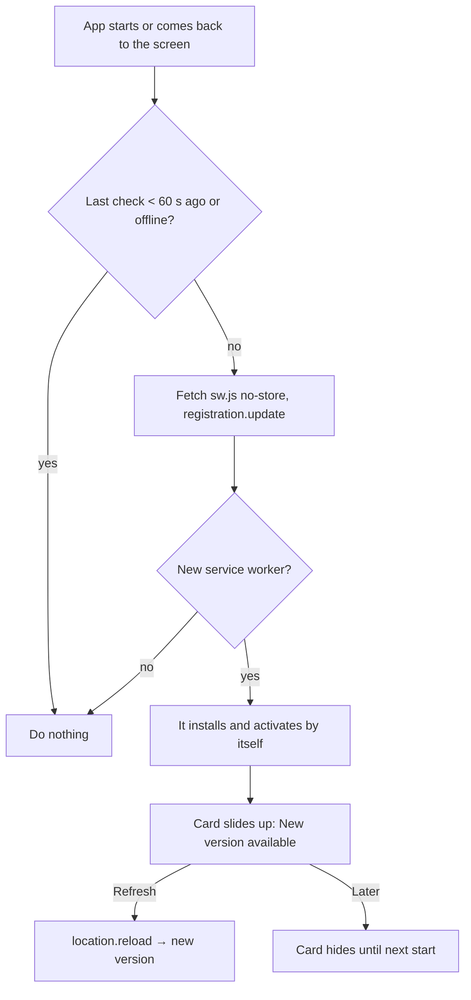

# Update prompt — plan

> **Status:** Shipped · **Owner:** @stanislavSav · **Decided:** 2026-10-12
> **Vocabulary:** [docs/CONTEXT.md](../CONTEXT.md) · **Decisions:** [docs/README.md](../README.md) G5, G7 ·
> **Tasks:** [tasks/](tasks/README.md) · **Parking lot:** [parking-lot/](parking-lot/README.md)

## 1. Why

The owner's iPhone kept showing an old version of the app, even after closing and opening it. The app checks for a
new version only when it really starts, and iOS usually wakes a Home Screen app from memory instead of starting it
again. So the check never runs, and nobody knows that a new version exists.

After this change the app looks for a new version in the background, also when it comes back to the screen. When a
new version is ready, a card slides up: "New version available" with a **Refresh** button.

## 2. Scope

**In:**

- Background update checks: when the app starts, every time it comes back to the screen, when the network comes
  back, and every 30 minutes while it is open. At most one check per minute.
- An "update ready" card with a slide-up transition, **Refresh** and **Later**, in English and Ukrainian.
- Settings → About: the build date and short commit id next to the version, and a **Check for updates** row.

**Out, deliberately:**

- Release notes in the card (no server, no changelog file). The card says only that a new version exists.
- Forcing a reload without asking. The user may be in the middle of typing a trade.

## 3. Decisions

| #   | Question | Decision |
| --- | -------- | -------- |
| D1  | Why did phones stay on the old version, and how is it fixed? | Root cause: `vite.config.ts` uses `injectRegister: false` (we register in `src/main.tsx`), and vite-plugin-pwa turns on `skipWaiting`/`clientsClaim` for `registerType: 'autoUpdate'` only when `injectRegister` is `'auto'` (`node_modules/vite-plugin-pwa/dist/index.js`, "workbox.skipWaiting = true"). So every new worker waited until all windows were closed, which iOS rarely does. Fix: set `skipWaiting: true` and `clientsClaim: true` in `workbox` explicitly. The new worker takes over at once; old clients (auto mode) reload themselves; the new client passes `onNeedReload` and shows the card instead of reloading. Verified in headless Chrome: a stuck "waiting" worker is replaced by the next build, the card appears, Refresh loads the new build. |
| D2  | When to check | Start, `visibilitychange` → visible, `online`, and a 30-minute interval while visible; throttle to one check per 60 s. Before `registration.update()`, fetch the service-worker URL with `cache: 'no-store'` and skip when offline (pattern from the vite-plugin-pwa "periodic SW updates" guide). |
| D3  | What does Refresh do | `location.reload()`. The new worker is already active, so the reload loads the new version. |
| D4  | What does Later do | Hides the card for this session. The next start loads the new version anyway. |
| D5  | Where is the card | Bottom of the screen above the + button, outside `#root` (like the toast), so it shows over sheets. Not modal; it does not take focus. `role="status"` region so screen readers announce it. |
| D6  | Transition | Slide up + fade in with a slight overshoot (≈0.45 s); the global `prefers-reduced-motion` rule in `styles.css` turns it off. |
| D7  | Build id | `__APP_BUILD__` = short commit id (`GITHUB_SHA` in CI, else `git rev-parse`) + build date, set by `define` in `vite.config.ts`. Shown in Settings → About. |

**Defaults decided without a question** (reversible): 30-minute interval; card texts "New version available" /
"Refresh to load it." (UK «Доступна нова версія» / «Оновіть, щоб завантажити її.»); Check for updates shows a toast
"You have the latest version" or "Downloading the new version…".

## 4. User flow



## 5. Screens

```
│ … list …                                 │
│ ┌──────────────────────────────────────┐ │
│ │ ↻  New version available             │ │
│ │    Refresh to load it.               │ │
│ │                    [Later] [Refresh] │ │
│ └──────────────────────────────────────┘ │
│                                     (+)  │
└──────────────────────────────────────────┘

Settings → About
│ Trade Journal                    0.1.0   │
│ Build 2026-10-12 · a1b2c3d               │
│ Check for updates                    ↻   │
```

## 6. Architecture

- `src/pwa/updates.ts` (new): `startUpdateChecks()` wraps `registerSW` from `virtual:pwa-register` and owns the
  triggers; a tiny store (`subscribe` / `getSnapshot`) for "update ready"; `checkForUpdates()` for the About row;
  pure `shouldCheck(now, lastCheck)` for the throttle.
- `src/main.tsx`: calls `startUpdateChecks()` instead of `registerSW({ immediate: true })`.
- `src/ui/UpdateBanner.tsx` (new): reads the store with `useSyncExternalStore`, renders the card through a portal.
- `src/ui/SettingsSheet.tsx`: build line and Check for updates row.
- `vite.config.ts`: `__APP_BUILD__` define; `src/vite-env.d.ts`: its type.
- Strings in a new `update` block in `src/i18n/en.ts` and `uk.ts`.

## 7. Libraries

No new library. `virtual:pwa-register` (vite-plugin-pwa 1.3.0, MIT) is already used.

## 8. Constraints that shape the design

- iOS rarely restarts Home Screen apps; `visibilitychange` is the only reliable "user is back" signal.
- GitHub Pages serves `sw.js` with `cache-control: max-age=600`; the `no-store` fetch and the browser's own update
  rules avoid the HTTP cache for the worker script.
- Demo mode: the card works the same; Refresh keeps `?demo` because it reloads the same URL.

## 9. Risks

| Risk | Likelihood | Impact | Mitigation |
| ---- | ---------- | ------ | ---------- |
| An old page asks for a logo file that the new version removed | Low | A missing icon until Refresh | The card asks the user to refresh right away |
| Checks cost battery or data | Low | Small | Throttle, visible-only interval, `sw.js` is ~6 KB |
| A phone still on a build from before this change | Medium | It needs one real start to get the new client | Owner steps in §10 |

## 10. Rollout

Push to `main`; GitHub Pages deploys. Phones on an older build: close the app in the app switcher and open it again,
then wait about 30 seconds with the app open; the old client reloads itself when the new worker activates. Last
resort, only after **Save backup**: delete the Home Screen app, add it again from Safari, **Load backup** (deleting a
Home Screen app on iOS deletes its data).

## 11. Open, deliberately

Questions that come up while building go to [parking-lot/](parking-lot/README.md).
